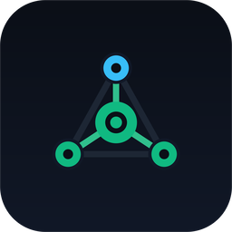
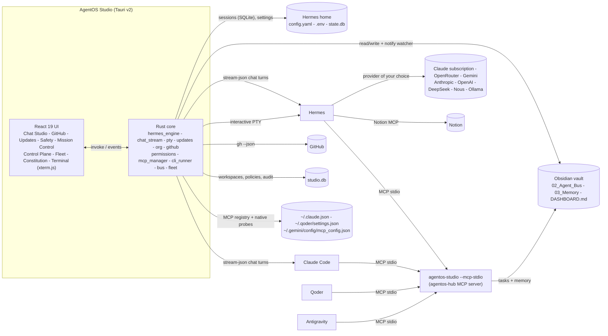

<p align="center">
  
</p>

<h1 align="center">AgentOS Studio</h1>

<p align="center">
  <b>Stop copy-pasting prompts between terminals and IDEs.</b><br />
  Turn Hermes, your Claude subscription, Qoder, Antigravity, Obsidian and Notion into one autonomous engineering fleet.<br />
  A sovereign AI workstation: chat, providers, MCP and the CLI in one native app.
</p>

<p align="center">
  <a href="https://github.com/konethegreat/agentos-studio/actions/workflows/ci.yml"></a>
  
  
  
  
</p>

---

Wiring a multi-agent setup by hand means hours of `PATH` fixes, CLI installs, OAuth logins, Python virtualenvs and hand-edited JSON in four different config files. Then you still end up pasting prompts from one tool into another and opening a terminal for every `hermes` or `claude` command.

**AgentOS Studio replaces all of that with one native desktop app and one Rust binary.** Everything the `hermes` and `claude` CLIs do in a terminal, Studio does in a window.

- **Hermes Chat Studio.** A Claude-Desktop-style chat over Hermes (or Claude Code), bound to any of your repositories. Replies stream in with rendered Markdown, highlighted code blocks with Copy and Apply-to-file, and expandable cards for every MCP and tool call. Your whole Hermes history is in the sidebar, read straight from `state.db`, with rename, delete and export to Obsidian.
- **Hot-swap provider switchboard.** Run on your Claude Pro or Max subscription today, then move to OpenRouter, Gemini, the Anthropic or OpenAI APIs, DeepSeek, Nous Portal or a local Ollama model from a dropdown. Keys go into Hermes's own `.env`, and every switch can be checked with a live test turn.
- **Universal MCP router.** One table of every MCP server across Hermes, Claude Code, Qoder and Antigravity: which agent has it, whether it answers, how fast, and every tool it exposes. Add servers from a one-click catalog, sync them to all four agents, toggle them per conversation, or run OAuth sign-in.
- **Native Rust MCP bus.** The same binary run with `--mcp-stdio` is `agentos-hub`: 9 tools for a shared task queue, typed memory and ranked recall, no Python, a full initialize plus tools/list round trip in about 35 ms.
- **Real terminals.** A docked panel with true PTY terminals (ConPTY on Windows) for interactive Hermes, the Hermes TUI, Claude Code or your shell, plus a one-shot command runner. Any chat can be continued in a terminal with one click.
- **Workspaces and folders.** Organise chats into workspaces, folders and sub-folders with drag and drop, pins, tags, archive and file attachments. Map a folder to a repository and every chat run there lands in it automatically; link it to a Hermes project.
- **GitHub.** Pull requests (diff, checks, review, merge, create), issues, Actions runs (failed logs, re-run), branches and commits, all through your `gh` login, with "Ask Hermes" hand-offs into chat.
- **Update Center.** Hermes, Claude Code and Studio are checked automatically, with an in-app alert, an OS notification and a readable changelog. Update, Skip this version or Remind me later; every update is backed up first and can be rolled back.
- **Safety.** Per-action permission policies (allow, ask, deny) enforced in the Rust core, approval prompts for anything destructive, and an audit log.
- **Live Mission Control, fleet manager and constitution studio.** The Kanban board over your vault, rule sync for every local repository, and one-click broadcast of your agent constitution, all from v0.1.

## What is new in v0.3.0

| Area | v0.2 | v0.3 |
|---|---|---|
| Terminal | Line-based command runner | Real PTY terminals (interactive Hermes, Hermes TUI, Claude Code, shell) next to the runner; "Continue in terminal" for any chat |
| Organisation | Flat session list | Workspaces > folders > sub-folders > chats, drag and drop, pins, tags, archive, attachments, folders mapped to repos and Hermes projects |
| GitHub | Token helper for the GitHub MCP server | Full GitHub view: PRs, reviews, merges, issues, Actions, branches, commits; `/gh` in chat; "Ask Hermes" hand-offs |
| Updates | None | Update Center for Hermes, Claude Code and Studio with notifications, changelogs, skip and snooze, backups and rollback |
| Safety | Ad-hoc confirms | Permission policies enforced in Rust, approval modal, audit log |
| Navigation | Sidebar | Command palette (Ctrl+K), Alt+1 to Alt+9, tooltips on every new control |

Design docs: [docs/ARCHITECTURE.md](docs/ARCHITECTURE.md) (diagram, components, data model), [docs/ROADMAP.md](docs/ROADMAP.md) (phases, and what each depends on), [docs/PARITY.md](docs/PARITY.md) (capability scorecard against the tools users compare us to), [docs/MODEL-ROUTER.md](docs/MODEL-ROUTER.md) (design for automatic model selection in v0.6.0) and [docs/adr/0001-v0.3-stack.md](docs/adr/0001-v0.3-stack.md) (stack changes and what was refused).

## What is new in v0.2.0

| Area | v0.1 | v0.2 |
|---|---|---|
| Talking to agents | Fire-and-forget missions | Streaming chat with session history, resume, tool cards, code Apply, slash commands |
| Model choice | Whatever `hermes model` set | Visual switchboard for 8 providers with key storage, model lists and live tests |
| MCP | Wire `agentos-hub` into four tools | Manage every server in every agent, catalog, native latency and tool inspection |
| CLI access | External terminal | Terminal drawer inside the app |
| Status | 6-pillar health pill | Live heartbeat: Hermes version, provider, model, MCP servers |

## How it fits together



The vault is the single source of truth for work: every task is a Markdown file with YAML frontmatter that moves `Pending/ -> In_Progress/ -> Completed/`. Hermes stays the source of truth for conversations and settings: Studio reads its files directly and changes them through the `hermes` CLI, so Hermes's own validation always runs.

## Download

Grab the latest installer from [Releases](https://github.com/konethegreat/agentos-studio/releases/latest):

| Platform | File |
|---|---|
| Windows 10 / 11 | `AgentOS Studio_<version>_x64-setup.exe` (NSIS) or `_x64_en-US.msi` |
| macOS | `_aarch64.dmg` (Apple Silicon) or `_x64.dmg` (Intel) |
| Linux | `.AppImage`, `.deb` or `.rpm` |

Builds are not code-signed yet, so Windows SmartScreen and macOS Gatekeeper ask for confirmation on first launch. Every `v*` tag is built for all three platforms by [`.github/workflows/release.yml`](.github/workflows/release.yml).

## Build from source

Prerequisites: [Rust](https://rustup.rs) (stable), Node.js 20+, and the [Tauri v2 system dependencies](https://v2.tauri.app/start/prerequisites/) for your OS (WebView2 is already present on Windows 10 and 11).

```bash
git clone https://github.com/konethegreat/agentos-studio.git
cd agentos-studio
npm install
npm run tauri dev        # run the desktop app with hot reload
npm run tauri build      # produce an installer in src-tauri/target/release/bundle
```

On first launch open **Setup and Integrations** and press **Auto-Setup and Repair Everything**. Anything missing gets installed, and sign-in windows open for Claude, GitHub and Notion. When it finishes, the health pill turns green: **All 6 Systems Connected**.

## The six pillars

| # | Pillar | What Studio checks | What the fix button runs |
|---|---|---|---|
| 1 | Claude Subscription Bridge | `claude --version`, `claude auth status`, Hermes plugin | `winget install Anthropic.ClaudeCode` or `npm i -g @anthropic-ai/claude-code`, `claude auth login`, `hermes plugins install claude-subscription-directsdk` |
| 2 | Hermes Agent Engine | `hermes --version`, default model in `config.yaml` | Official Hermes installer, `hermes model` |
| 3 | Obsidian Shared Brain | `00_Inbox` to `04_Agent_Engine` tree | Scaffolds the vault and seed files at any folder you pick |
| 4 | Notion Cloud Sync | Notion MCP server configured and authorized in Hermes | `hermes mcp install notion`, `hermes mcp login notion` |
| 5 | AgentOS Rust MCP Bus | Self-test over stdio (`initialize` + `tools/list` returns 9 tools), Hermes registration | `hermes mcp add agentos-hub --command <studio> --args --mcp-stdio --vault <vault>` |
| 6 | IDE Fleet Connectors | `agentos-hub` in `~/.claude.json`, `~/.qoder/settings.json`, `~/.gemini/config/mcp_config.json` | `claude mcp add` and JSON merges (existing files are backed up once) |

Foundations (Git, GitHub CLI, Node, user `PATH` entries for `~/.local/bin`, npm and Cargo) are checked and repaired the same way. Studio also resolves tools through the persisted user `PATH`, so a freshly installed CLI works without restarting the app.

## Hermes Chat Studio

The home screen. Pick a working directory (any of your repositories, or any folder), choose **Hermes** or **Claude Code**, and type.

- Each message runs one `hermes chat --format stream-json` turn inside that folder (or `claude -p --output-format stream-json --include-partial-messages`). Continuing a conversation resumes the same session, so context carries over.
- The Rust parser turns the stream into `token`, `tool_start`, `tool_result`, `error` and `complete` events. Tool calls render as cards showing the MCP server, the tool, its input, its result and how long it took. MCP calls that Hermes routes through its `tool_call` wrapper are shown under the real server and tool.
- Code blocks have **Copy** and **Apply**. Apply writes the block to a file inside the working directory (paths outside it are refused) and keeps the file's line endings.
- **Stop** ends the turn immediately and keeps the partial reply.
- The chat list shows every Hermes conversation from `state.db` with search, and each one can be renamed, deleted or exported to `03_Memory/Hermes_Sessions/` in your vault, where `search_shared_memory` can find it.
- The header pill switches provider, model and the MCP servers Hermes loads, without leaving the conversation.
- Slash commands: `/doctor` runs `hermes doctor` in the terminal, `/mcp-test` pings every MCP server, `/delegate-to-kanban <task>` queues a task on the Agent Bus, and `/sync-notion` has Hermes update your AgentOS Command Center page in Notion.

## MCP and provider switchboard

**Providers.** One card per provider: Claude Subscription (DirectSDK), OpenRouter, Google Gemini, Anthropic API, OpenAI API, DeepSeek, Nous Portal and Local (Ollama, llama.cpp or vLLM; Ollama is detected on `localhost:11434`). Each card shows whether it is ready, suggests models from Hermes's model caches or Ollama, accepts an API key, and has **Activate Provider**, **Test connection** and, for subscription and OAuth providers, **Sign in**.

- Switching runs `hermes config set model.provider`, `model.default` and `model.base_url`. Keys are passed to `hermes config set <NAME>_API_KEY`, which stores them in Hermes's `.env`. Studio only ever displays key names, never values.
- Switching to a provider without a key is refused before anything is written.
- **Test connection** runs one real turn on that provider and model, reports the reply and latency, then deletes the probe session so your history stays clean.

**MCP Server Hub.** Every server from all four agents in one list, with H, C, Q and A badges for Hermes, Claude Code, Qoder and Antigravity. Amber means that agent points somewhere else, and clicking a missing badge adds the server there.

- Stdio servers are tested by a native Rust MCP client (`initialize`, then every page of `tools/list`). HTTP and OAuth servers are tested through `hermes mcp test`.
- **Test and Inspect** opens every tool with its JSON schema.
- **Add from Catalog** installs AgentOS-Hub (Rust), Notion, GitHub, Filesystem, Brave Search, Postgres, SQLite or Playwright, optionally into all four agents at once. The GitHub token can be filled from your `gh` login.
- Hermes and Claude Code are changed through their CLIs (`hermes mcp add/remove`, `claude mcp add/remove`). Qoder and Antigravity JSON files are merged in place with a one-time backup and their original line endings.
- If any agent still runs `agentos-hub` from the old Python server, one button points all four at this binary.

## Startup and diagnostics

Every launch runs eight bounded checks and shows them on a boot screen: app folders, the tool
search path, settings, `studio.db`, the vault structure, the connected tools (git, node, gh, hermes,
claude), the Hermes configuration, and whether `agentos-hub` is registered with the agents.

- Safe repairs run automatically: missing folders, database migrations, PATH entries, and missing
  vault folders. Anything that writes another tool's configuration, installs software or signs in
  is listed with a **Fix** button instead of being changed behind your back.
- **Diagnostics** (sidebar) shows every check with its duration, the boot log, the crash log, and a
  **Re-run checks** button. Panics are written to `logs/crash.log` with a backtrace, and the next
  launch surfaces them, so nothing dies silently.
- **One instance only:** launching again focuses the window you already have instead of starting a
  second copy of the app and all its background work.

Logs live in `%APPDATA%\agentos-studio\logs` (`boot.log`, `crash.log`); the **Logs folder** button
opens them.

## Terminal

Press **Terminal** in the status bar (or `` Ctrl+` ``) for the panel docked under the app. It has two kinds of tabs:

- **Commands**: one-shot commands through PowerShell (or `sh`) in the folder you pick, with live stdout and stderr, Stop, history and quick actions (`hermes doctor`, `hermes mcp list`, `hermes status`, `claude auth status`, `claude mcp list`, `git status`, `gh auth status`).
- **Real terminals** (press **+**): a pseudo terminal (ConPTY on Windows, openpty on macOS and Linux) rendered with xterm.js. Pick **Shell**, **Hermes** (the interactive REPL, with live reasoning, slash commands and typed approvals), **Hermes TUI** or **Claude Code**. Terminals keep running while the panel is hidden, survive a UI reload, and are stopped when Studio exits.

**Continue in terminal** in the chat header opens the current conversation with `hermes --resume <id>` (or `claude --resume <id>`) in a new terminal tab. Only these programs can be started this way, and session ids are validated before they reach the command line.

## Workspaces and folders

The chat sidebar is a tree: **workspaces > folders > sub-folders > chats**, plus **Pinned** and **Unfiled**.

- Drag chats onto folders or workspaces, and folders into other folders or workspaces (cycles are refused). F2 renames, the row menu has everything else: tags (search with `#tag`), pin, archive (hidden until **Archived** is ticked), export to Obsidian and delete.
- **Map to a directory**: chats whose working directory is inside a folder's directory appear in it automatically (longest match wins, marked `auto`). **New chat** on a mapped folder starts in that directory and files the chat there.
- **Link to a Hermes project**: reuses the Hermes project that already contains the directory, or runs `hermes project create`.
- **Attach files** to a chat or a folder. When you send a message, the attached paths of the chat and every parent folder are listed at the top of the prompt for the agent, and the chat shows which files were included. Files are referenced, never copied.
- Deleting a folder or workspace never deletes chats; they return to Unfiled. Hermes sessions stay in Hermes's `state.db`; placement lives in Studio's `studio.db`.

## Navigation

A five-group icon rail replaces the old twelve-item list: **Chat**, **Work** (Projects, Mission
Control, Fleet), **Brain** (Skills, Constitution), **Code** (GitHub) and **System** (MCP and
Providers, Updates, Safety, Setup, Diagnostics). The rail is 56 px, expands on hover, and stays open
if you pin it. Badges count open bus tasks on Work, waiting updates on System and failing CI runs on
Code. `Alt+1..5` jumps between groups and `Ctrl+K` reaches every tab.

Chats never start in a system folder: the working directory comes from the last folder you used,
then the active project, then your home directory. Anything under `%WINDIR%` or `System32` is
rejected.

## Projects, branches and skills

- **Projects** are Hermes projects: a named workspace over one or more folders (`hermes project`).
  The Projects view lists each project with its folders and every chat that ran inside them,
  matched with the same longest-prefix rule Hermes uses. Create, rename, add a folder, archive or
  restore, and start a new chat directly in the project folder.
- **Session branches.** Any chat in a project can spin off a separate one with its own parent link,
  so "one chat per concern" does not mean losing where it came from. The child is a real Hermes
  session in the same folder; Studio records the relationship in `studio.db` and nothing else.
- **Skills.** The Skills view reads the installed skills tree (`SKILL.md` frontmatter plus the full
  body), searches the registries and installs through `hermes skills`, and removes or updates them.
  **Use in a chat** attaches a skill to the conversation, which passes `-s <skill>` to Hermes on
  every turn, so the agent loads it on purpose instead of hoping it notices.

## GitHub

The GitHub view works through your `gh` login (Studio never sees the token). Pick a repository (local clones found by the fleet scan are marked) and use the tabs:

- **Pull requests**: state filter, check status, diff, files, reviews and comments; **Submit review** (comment, approve, request changes), **Merge** (squash, merge or rebase, optional branch delete), comment, and **New PR** from a local clone.
- **Issues**: create, comment, close as completed or not planned.
- **Actions**: runs with job and step status, the failed-step log, **Re-run failed jobs** or all jobs.
- **Branches** and **Commits** per branch.

**Ask Hermes to review / fix / diagnose** hands a PR, issue or failed run to Chat Studio with a prepared prompt, inside the local clone when there is one. In chat, `/gh <args>` runs any `gh` command in the terminal. Writes go through the permission policies below.

## Update Center

Hermes (`hermes update --check` plus its GitHub release notes), Claude Code (the npm registry plus its `CHANGELOG.md`) and AgentOS Studio (GitHub releases) are checked 20 seconds after start and every 6 hours. A new version shows a banner and, once per version, an OS notification with a short summary. Each product card shows the changes grouped by section, and offers **Update**, **Skip this version** and **Remind me later**. Offline or failed checks say "Could not check", never "Up to date".

Every update is backed up first, under `%APPDATA%\agentos-studio\backups` (or the platform config directory):

| Product | Backup | Update | Roll back |
|---|---|---|---|
| Hermes | `hermes backup --quick` state snapshot plus the exact code commit | `hermes update --yes` (restarts the gateway) | Pins the code to the recorded commit; **Restore state** opens a Hermes terminal with `/snapshot restore <id>` typed in |
| Claude Code | The installed version is recorded | `claude update` | `claude install <version> --force` |
| Studio | The installed version is recorded | Downloads the release installer, verifies its SHA-256 against GitHub's digest, runs it | Installs the previous release the same way |

Studio copies built from source (running out of `target\release`) are not replaced by an installer, because agents point their `agentos-hub` registration at that path; the card says to pull and rebuild instead.

## Safety

**Safety** lists every sensitive action with a policy of **allow**, **ask** or **deny**: merging, reviewing and creating PRs, creating, commenting on and closing issues, re-running workflows, installing updates and rollbacks, deleting workspaces and folders, linking Hermes projects and deleting Hermes sessions. The check runs in the Rust core before the action, so it covers buttons, chat commands and the palette alike. **Ask** shows an approval prompt that says exactly what will run; ticking "Always allow" switches that action to allow. Every guarded action, its outcome and policy changes are written to the audit log, which is searchable in the same view.

## Command palette and keyboard

`Ctrl+K` opens the command palette: every screen, new terminals, Hermes diagnostics, update checks and more. `Alt+1` to `Alt+9` switch screens, `` Ctrl+` `` toggles the terminal, F2 renames in the chat tree.

## The native MCP server

The desktop binary doubles as the MCP server. No GUI starts in this mode, and stdout carries only JSON-RPC.

```bash
agentos-studio --mcp-stdio --vault "/path/to/your/vault"
```

Register it with any MCP client. Studio's Setup view does this for you; manually it looks like this:

```bash
claude mcp add agentos-hub --scope user -- /path/to/agentos-studio --mcp-stdio --vault "/path/to/vault"
```

```json
{
  "mcpServers": {
    "agentos-hub": {
      "command": "C:\\Program Files\\AgentOS Studio\\agentos-studio.exe",
      "args": ["--mcp-stdio", "--vault", "C:\\Users\\you\\Obsidian\\My vault"]
    }
  }
}
```

| Tool | Purpose |
|---|---|
| `delegate_task(title, assigned_to, creator, project, context_files, instructions, priority)` | Create a task in `02_Agent_Bus/Pending/` for `hermes`, `claude-code`, `qoder`, `antigravity` or `human` |
| `fetch_pending_tasks(agent_name)` | Open tasks for one agent or `all`, sorted by priority |
| `claim_task(task_id, agent_name)` | Move a task to `In_Progress/` |
| `complete_task(task_id, agent_name, summary_of_work)` | Move a task to `Completed/` with a completion summary |
| `write_shared_memory(topic, content, category, type?)` | Create or append a note in `03_Memory/`. Only `type=decision` (the default) reaches `DECISION_LOG.md` |
| `search_shared_memory(query)` | Simple keyword search across `01_Projects/` and `03_Memory/` |
| `recall(query, repo?, k=8, max_tokens=1500)` | Ranked recall from the FTS5 index: bm25 plus recency and wikilink in-degree, superseded notes last, chunks with path and line |
| `remember(type, topic, content, supersedes?)` | Typed write: decision, fact, convention, episode or gotcha, with optional supersede |
| `project_brief(repo)` | One page: purpose, stack, commands, open tasks, last five decisions, gotchas |

Every state change regenerates the task section of `DASHBOARD.md`. Writes are atomic and guarded by a cross-process lock, so the GUI, the MCP server and other tools can share one vault safely. The file format is compatible with the original AgentOS Python server.

## Mission Control

Type a one-line goal in the command bar, pick a repository and an agent, and press **Dispatch Mission**.

- **Hermes / Auto** and **Claude Code** missions are claimed and run immediately as headless workers (`hermes chat --oneshot --query-file`, `claude -p --output-format stream-json`). Output streams live into the slide-over worker drawer, which also has **Stop Worker**.
- **Qoder** and **Antigravity** missions are queued on the bus. The rule files tell those IDE agents to call `fetch_pending_tasks` at the start of every session.
- Every card has **Run Now (Hermes)**, **Run Now (Claude)**, **Move State** and **View Spec / Logs**. Worker logs are kept in `04_Agent_Engine/worker_logs/`.

Claude Code workers run with `--permission-mode acceptEdits` and access to the `agentos-hub` tools. Tool permissions beyond that follow your own Claude Code settings.

## Fleet and constitution

- **Fleet Repositories** scans your home folder (plus OneDrive Desktop and Documents) for Git repos and shows stack, branch, status, uncommitted files and whether the rules are synced.
- **Sync Constitution** writes managed blocks into `CLAUDE.md`, `AGENTS.md` and `GEMINI.md` (your own text outside the block is preserved), plus `.qoder/rules/agentos.md`, `.agents/rules/agentos.md` and a `.gitignore` section for local agent caches. With **Commit rule files only**, the commit is built from `HEAD` plus those files in a private index. Your staged and unstaged work stays exactly where it was.
- **New AgentOS Project** creates the folder, runs `git init`, lays down a Rust, TypeScript or Python starter, injects the rules, makes the first commit, optionally creates the GitHub repo with `gh`, writes the `01_Projects/<name>.md` note and queues a Notion sync task for Hermes.
- **Save and Broadcast** writes `CONSTITUTION.md` and `SYSTEM_CONTEXT.md`, regenerates the vault templates, updates `~/.claude/CLAUDE.md`, `~/.qoder/AGENTS.md` and `~/.gemini/GEMINI.md`, and syncs every repository. Disabled laws are left out of every generated file.

## Project layout

```
src/                      React 19 + TypeScript + Tailwind 4 UI
  views/                  ChatStudio, GitHubView, UpdateCenter, SafetyCenter, MissionControl, ControlPlane, FleetManager, ConstitutionStudio, SetupWizard
  components/             WorkspaceTree, PtyTerminal, CliDrawer, CommandPalette, ApprovalProvider, Updates, StatusBar, ProviderSwitcher, Markdown, ToolCard, CommandBar, TaskCard, WorkerDrawer, UI kit
  lib/api.ts              Typed bindings for the v0.1 and v0.2 Rust commands and events
  lib/studio.ts           Typed bindings for terminals, updates, organisation, GitHub and safety
  lib/chat.ts             Stream event reducer and history loader
src-tauri/src/
  main.rs                 GUI by default, MCP server with --mcp-stdio
  hermes_engine.rs        Heartbeat, provider switchboard, model discovery, state.db sessions
  chat_stream.rs          Streaming chat turns for Hermes and Claude Code, event parsers, Apply
  mcp_manager.rs          MCP registry across four agents, native MCP client, catalog
  cli_runner.rs           One-shot command runner
  pty.rs                  Real terminals (portable-pty) with replayable scrollback
  updates.rs              Version checks, changelogs, backups, updates and rollback
  org.rs                  Workspaces, folders, chat placement, tags, attachments, Hermes projects
  github.rs               gh wrappers for repos, PRs, issues, Actions, branches, commits
  permissions.rs          Permission policies, approval guard, audit log
  store.rs                studio.db (SQLite) and migrations
  ops.rs                  Tauri commands for the v0.3 modules
  mcp_stdio.rs            JSON-RPC 2.0 MCP server (agentos-hub)
  vault.rs                Task bus, shared memory, dashboard, cross-process lock
  bootstrapper.rs         Stack detection, installers, OAuth launchers, registrations
  bus.rs                  notify watcher, mission dispatch, headless workers
  fleet.rs                Repo scanner, rule sync, rules-only commits, project creator
  constitution.rs         Managed blocks, law toggles, line-ending safe writes
  broadcast.rs            Save and Broadcast
src-tauri/tests/          Native MCP probe against the real binary, plus opt-in live tests
docs/                     Architecture, roadmap, parity and ADRs
templates/CONSTITUTION.md Default constitution bundled into the binary
```

## Development

```bash
npm run build                 # tsc + vite
npm run check:dashes          # repository-wide em-dash / en-dash gate
cd src-tauri
cargo fmt --check
cargo clippy --all-targets -- -D warnings
cargo test                    # unit tests plus the native MCP probe

# Opt-in checks against a real Hermes and Claude Code install on this machine
cargo test --test live_smoke -- --ignored --nocapture
cargo test --test live_chat -- --ignored --nocapture
cargo test --test live_v3 -- --ignored --nocapture --test-threads 1   # PTY, updates, GitHub
```

The live tests read your Hermes sessions, providers and MCP servers, run real chat turns on both backends (then delete the session they created), and re-apply your active provider without changing it. `live_v3` runs PowerShell and interactive Hermes inside a real PTY, checks all three update channels against the network, and reads PRs, diffs, branches, commits, runs and issues of this repository through `gh` (read-only).

Contributions follow the AgentOS constitution in [`CLAUDE.md`](CLAUDE.md): branch, atomic conventional commits, PR, self-review, squash merge.

## License

[MIT](LICENSE)
