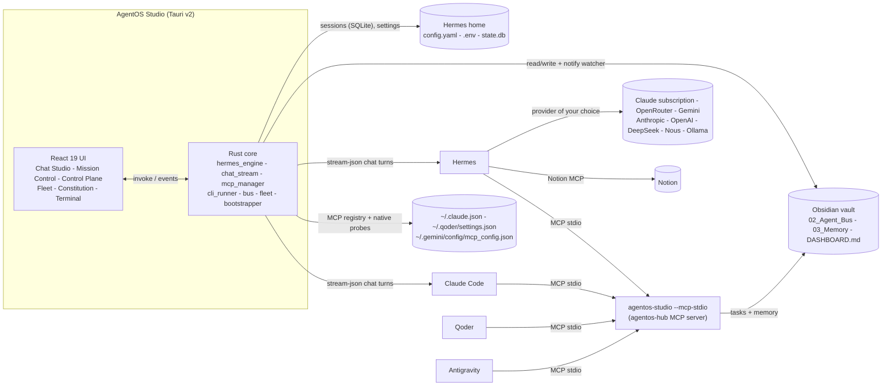

<p align="center">
  
</p>

<h1 align="center">AgentOS Studio</h1>

<p align="center">
  <b>Stop copy-pasting prompts between terminals and IDEs.</b><br />
  Turn Hermes, your Claude subscription, Qoder, Antigravity, Obsidian and Notion into one autonomous engineering fleet.<br />
  A sovereign AI workstation: chat, providers, MCP and the CLI in one native app.
</p>

<p align="center">
  <a href="https://github.com/konethegreat/agentos-studio/actions/workflows/ci.yml"></a>
  
  
  
  
</p>

---

Wiring a multi-agent setup by hand means hours of `PATH` fixes, CLI installs, OAuth logins, Python virtualenvs and hand-edited JSON in four different config files. Then you still end up pasting prompts from one tool into another and opening a terminal for every `hermes` or `claude` command.

**AgentOS Studio replaces all of that with one native desktop app and one Rust binary.** Everything the `hermes` and `claude` CLIs do in a terminal, Studio does in a window.

- **Hermes Chat Studio.** A Claude-Desktop-style chat over Hermes (or Claude Code), bound to any of your repositories. Replies stream in with rendered Markdown, highlighted code blocks with Copy and Apply-to-file, and expandable cards for every MCP and tool call. Your whole Hermes history is in the sidebar, read straight from `state.db`, with rename, delete and export to Obsidian.
- **Hot-swap provider switchboard.** Run on your Claude Pro or Max subscription today, then move to OpenRouter, Gemini, the Anthropic or OpenAI APIs, DeepSeek, Nous Portal or a local Ollama model from a dropdown. Keys go into Hermes's own `.env`, and every switch can be checked with a live test turn.
- **Universal MCP router.** One table of every MCP server across Hermes, Claude Code, Qoder and Antigravity: which agent has it, whether it answers, how fast, and every tool it exposes. Add servers from a one-click catalog, sync them to all four agents, toggle them per conversation, or run OAuth sign-in.
- **Native Rust MCP bus.** The same binary run with `--mcp-stdio` is `agentos-hub`: 6 tools for a shared task queue and shared memory, no Python, a full initialize plus tools/list round trip in about 35 ms.
- **Built-in terminal.** A docked console for any `hermes`, `claude`, `git`, `gh` or PowerShell command, with one-click quick actions.
- **Live Mission Control, fleet manager and constitution studio.** The Kanban board over your vault, rule sync for every local repository, and one-click broadcast of your agent constitution, all from v0.1.

## What is new in v0.2.0

| Area | v0.1 | v0.2 |
|---|---|---|
| Talking to agents | Fire-and-forget missions | Streaming chat with session history, resume, tool cards, code Apply, slash commands |
| Model choice | Whatever `hermes model` set | Visual switchboard for 8 providers with key storage, model lists and live tests |
| MCP | Wire `agentos-hub` into four tools | Manage every server in every agent, catalog, native latency and tool inspection |
| CLI access | External terminal | Terminal drawer inside the app |
| Status | 6-pillar health pill | Live heartbeat: Hermes version, provider, model, MCP servers |

## How it fits together



The vault is the single source of truth for work: every task is a Markdown file with YAML frontmatter that moves `Pending/ -> In_Progress/ -> Completed/`. Hermes stays the source of truth for conversations and settings: Studio reads its files directly and changes them through the `hermes` CLI, so Hermes's own validation always runs.

## Download

Grab the latest installer from [Releases](https://github.com/konethegreat/agentos-studio/releases/latest):

| Platform | File |
|---|---|
| Windows 10 / 11 | `AgentOS Studio_<version>_x64-setup.exe` (NSIS) or `_x64_en-US.msi` |
| macOS | `_aarch64.dmg` (Apple Silicon) or `_x64.dmg` (Intel) |
| Linux | `.AppImage`, `.deb` or `.rpm` |

Builds are not code-signed yet, so Windows SmartScreen and macOS Gatekeeper ask for confirmation on first launch. Every `v*` tag is built for all three platforms by [`.github/workflows/release.yml`](.github/workflows/release.yml).

## Build from source

Prerequisites: [Rust](https://rustup.rs) (stable), Node.js 20+, and the [Tauri v2 system dependencies](https://v2.tauri.app/start/prerequisites/) for your OS (WebView2 is already present on Windows 10 and 11).

```bash
git clone https://github.com/konethegreat/agentos-studio.git
cd agentos-studio
npm install
npm run tauri dev        # run the desktop app with hot reload
npm run tauri build      # produce an installer in src-tauri/target/release/bundle
```

On first launch open **Setup and Integrations** and press **Auto-Setup and Repair Everything**. Anything missing gets installed, and sign-in windows open for Claude, GitHub and Notion. When it finishes, the health pill turns green: **All 6 Systems Connected**.

## The six pillars

| # | Pillar | What Studio checks | What the fix button runs |
|---|---|---|---|
| 1 | Claude Subscription Bridge | `claude --version`, `claude auth status`, Hermes plugin | `winget install Anthropic.ClaudeCode` or `npm i -g @anthropic-ai/claude-code`, `claude auth login`, `hermes plugins install claude-subscription-directsdk` |
| 2 | Hermes Agent Engine | `hermes --version`, default model in `config.yaml` | Official Hermes installer, `hermes model` |
| 3 | Obsidian Shared Brain | `00_Inbox` to `04_Agent_Engine` tree | Scaffolds the vault and seed files at any folder you pick |
| 4 | Notion Cloud Sync | Notion MCP server configured and authorized in Hermes | `hermes mcp install notion`, `hermes mcp login notion` |
| 5 | AgentOS Rust MCP Bus | Self-test over stdio (`initialize` + `tools/list` returns 6 tools), Hermes registration | `hermes mcp add agentos-hub --command <studio> --args --mcp-stdio --vault <vault>` |
| 6 | IDE Fleet Connectors | `agentos-hub` in `~/.claude.json`, `~/.qoder/settings.json`, `~/.gemini/config/mcp_config.json` | `claude mcp add` and JSON merges (existing files are backed up once) |

Foundations (Git, GitHub CLI, Node, user `PATH` entries for `~/.local/bin`, npm and Cargo) are checked and repaired the same way. Studio also resolves tools through the persisted user `PATH`, so a freshly installed CLI works without restarting the app.

## Hermes Chat Studio

The home screen. Pick a working directory (any of your repositories, or any folder), choose **Hermes** or **Claude Code**, and type.

- Each message runs one `hermes chat --format stream-json` turn inside that folder (or `claude -p --output-format stream-json --include-partial-messages`). Continuing a conversation resumes the same session, so context carries over.
- The Rust parser turns the stream into `token`, `tool_start`, `tool_result`, `error` and `complete` events. Tool calls render as cards showing the MCP server, the tool, its input, its result and how long it took. MCP calls that Hermes routes through its `tool_call` wrapper are shown under the real server and tool.
- Code blocks have **Copy** and **Apply**. Apply writes the block to a file inside the working directory (paths outside it are refused) and keeps the file's line endings.
- **Stop** ends the turn immediately and keeps the partial reply.
- The sidebar lists every Hermes conversation from `state.db` with search, and each one can be renamed, deleted or exported to `03_Memory/Hermes_Sessions/` in your vault, where `search_shared_memory` can find it.
- The header pill switches provider, model and the MCP servers Hermes loads, without leaving the conversation.
- Slash commands: `/doctor` runs `hermes doctor` in the terminal, `/mcp-test` pings every MCP server, `/delegate-to-kanban <task>` queues a task on the Agent Bus, and `/sync-notion` has Hermes update your AgentOS Command Center page in Notion.

## MCP and provider switchboard

**Providers.** One card per provider: Claude Subscription (DirectSDK), OpenRouter, Google Gemini, Anthropic API, OpenAI API, DeepSeek, Nous Portal and Local (Ollama, llama.cpp or vLLM; Ollama is detected on `localhost:11434`). Each card shows whether it is ready, suggests models from Hermes's model caches or Ollama, accepts an API key, and has **Activate Provider**, **Test connection** and, for subscription and OAuth providers, **Sign in**.

- Switching runs `hermes config set model.provider`, `model.default` and `model.base_url`. Keys are passed to `hermes config set <NAME>_API_KEY`, which stores them in Hermes's `.env`. Studio only ever displays key names, never values.
- Switching to a provider without a key is refused before anything is written.
- **Test connection** runs one real turn on that provider and model, reports the reply and latency, then deletes the probe session so your history stays clean.

**MCP Server Hub.** Every server from all four agents in one list, with H, C, Q and A badges for Hermes, Claude Code, Qoder and Antigravity. Amber means that agent points somewhere else, and clicking a missing badge adds the server there.

- Stdio servers are tested by a native Rust MCP client (`initialize`, then every page of `tools/list`). HTTP and OAuth servers are tested through `hermes mcp test`.
- **Test and Inspect** opens every tool with its JSON schema.
- **Add from Catalog** installs AgentOS-Hub (Rust), Notion, GitHub, Filesystem, Brave Search, Postgres, SQLite or Playwright, optionally into all four agents at once. The GitHub token can be filled from your `gh` login.
- Hermes and Claude Code are changed through their CLIs (`hermes mcp add/remove`, `claude mcp add/remove`). Qoder and Antigravity JSON files are merged in place with a one-time backup and their original line endings.
- If any agent still runs `agentos-hub` from the old Python server, one button points all four at this binary.

## Terminal

Press **Terminal** in the status bar (or `` Ctrl+` ``) for a console docked under the app. Commands run through PowerShell (or `sh`) in the folder you pick, stream stdout and stderr live, and can be stopped. Quick actions cover `hermes doctor`, `hermes mcp list`, `hermes status`, `claude auth status`, `claude mcp list`, `git status` and `gh auth status`. Interactive programs (bare `hermes`, `claude`, `hermes model`) are pointed to the matching Studio screen instead of hanging.

## The native MCP server

The desktop binary doubles as the MCP server. No GUI starts in this mode, and stdout carries only JSON-RPC.

```bash
agentos-studio --mcp-stdio --vault "/path/to/your/vault"
```

Register it with any MCP client. Studio's Setup view does this for you; manually it looks like this:

```bash
claude mcp add agentos-hub --scope user -- /path/to/agentos-studio --mcp-stdio --vault "/path/to/vault"
```

```json
{
  "mcpServers": {
    "agentos-hub": {
      "command": "C:\\Program Files\\AgentOS Studio\\agentos-studio.exe",
      "args": ["--mcp-stdio", "--vault", "C:\\Users\\you\\Obsidian\\My vault"]
    }
  }
}
```

| Tool | Purpose |
|---|---|
| `delegate_task(title, assigned_to, creator, project, context_files, instructions, priority)` | Create a task in `02_Agent_Bus/Pending/` for `hermes`, `claude-code`, `qoder`, `antigravity` or `human` |
| `fetch_pending_tasks(agent_name)` | Open tasks for one agent or `all`, sorted by priority |
| `claim_task(task_id, agent_name)` | Move a task to `In_Progress/` |
| `complete_task(task_id, agent_name, summary_of_work)` | Move a task to `Completed/` with a completion summary |
| `write_shared_memory(topic, content, category)` | Create or append a note in `03_Memory/` and log it in `DECISION_LOG.md` |
| `search_shared_memory(query)` | Ranked keyword search across `01_Projects/` and `03_Memory/` |

Every state change regenerates the task section of `DASHBOARD.md`. Writes are atomic and guarded by a cross-process lock, so the GUI, the MCP server and other tools can share one vault safely. The file format is compatible with the original AgentOS Python server.

## Mission Control

Type a one-line goal in the command bar, pick a repository and an agent, and press **Dispatch Mission**.

- **Hermes / Auto** and **Claude Code** missions are claimed and run immediately as headless workers (`hermes chat --oneshot --query-file`, `claude -p --output-format stream-json`). Output streams live into the slide-over worker drawer, which also has **Stop Worker**.
- **Qoder** and **Antigravity** missions are queued on the bus. The rule files tell those IDE agents to call `fetch_pending_tasks` at the start of every session.
- Every card has **Run Now (Hermes)**, **Run Now (Claude)**, **Move State** and **View Spec / Logs**. Worker logs are kept in `04_Agent_Engine/worker_logs/`.

Claude Code workers run with `--permission-mode acceptEdits` and access to the `agentos-hub` tools. Tool permissions beyond that follow your own Claude Code settings.

## Fleet and constitution

- **Fleet Repositories** scans your home folder (plus OneDrive Desktop and Documents) for Git repos and shows stack, branch, status, uncommitted files and whether the rules are synced.
- **Sync Constitution** writes managed blocks into `CLAUDE.md`, `AGENTS.md` and `GEMINI.md` (your own text outside the block is preserved), plus `.qoder/rules/agentos.md`, `.agents/rules/agentos.md` and a `.gitignore` section for local agent caches. With **Commit rule files only**, the commit is built from `HEAD` plus those files in a private index. Your staged and unstaged work stays exactly where it was.
- **New AgentOS Project** creates the folder, runs `git init`, lays down a Rust, TypeScript or Python starter, injects the rules, makes the first commit, optionally creates the GitHub repo with `gh`, writes the `01_Projects/<name>.md` note and queues a Notion sync task for Hermes.
- **Save and Broadcast** writes `CONSTITUTION.md` and `SYSTEM_CONTEXT.md`, regenerates the vault templates, updates `~/.claude/CLAUDE.md`, `~/.qoder/AGENTS.md` and `~/.gemini/GEMINI.md`, and syncs every repository. Disabled laws are left out of every generated file.

## Project layout

```
src/                      React 19 + TypeScript + Tailwind 4 UI
  views/                  ChatStudio, MissionControl, ControlPlane, FleetManager, ConstitutionStudio, SetupWizard
  components/             StatusBar, ProviderSwitcher, Markdown, ToolCard, CliDrawer, CommandBar, TaskCard, WorkerDrawer, UI kit
  lib/api.ts              Typed bindings for every Rust command and event
  lib/chat.ts             Stream event reducer and history loader
src-tauri/src/
  main.rs                 GUI by default, MCP server with --mcp-stdio
  hermes_engine.rs        Heartbeat, provider switchboard, model discovery, state.db sessions
  chat_stream.rs          Streaming chat turns for Hermes and Claude Code, event parsers, Apply
  mcp_manager.rs          MCP registry across four agents, native MCP client, catalog
  cli_runner.rs           In-app terminal
  mcp_stdio.rs            JSON-RPC 2.0 MCP server (agentos-hub)
  vault.rs                Task bus, shared memory, dashboard, cross-process lock
  bootstrapper.rs         Stack detection, installers, OAuth launchers, registrations
  bus.rs                  notify watcher, mission dispatch, headless workers
  fleet.rs                Repo scanner, rule sync, rules-only commits, project creator
  constitution.rs         Managed blocks, law toggles, line-ending safe writes
  broadcast.rs            Save and Broadcast
src-tauri/tests/          Native MCP probe against the real binary, plus opt-in live tests
templates/CONSTITUTION.md Default constitution bundled into the binary
```

## Development

```bash
npm run build                 # tsc + vite
npm run check:dashes          # repository-wide em-dash / en-dash gate
cd src-tauri
cargo fmt --check
cargo clippy --all-targets -- -D warnings
cargo test                    # unit tests plus the native MCP probe

# Opt-in checks against a real Hermes and Claude Code install on this machine
cargo test --test live_smoke -- --ignored --nocapture
cargo test --test live_chat -- --ignored --nocapture
```

The live tests read your Hermes sessions, providers and MCP servers, run real chat turns on both backends (then delete the session they created), and re-apply your active provider without changing it.

Contributions follow the AgentOS constitution in [`CLAUDE.md`](CLAUDE.md): branch, atomic conventional commits, PR, self-review, squash merge.

## License

[MIT](LICENSE)
