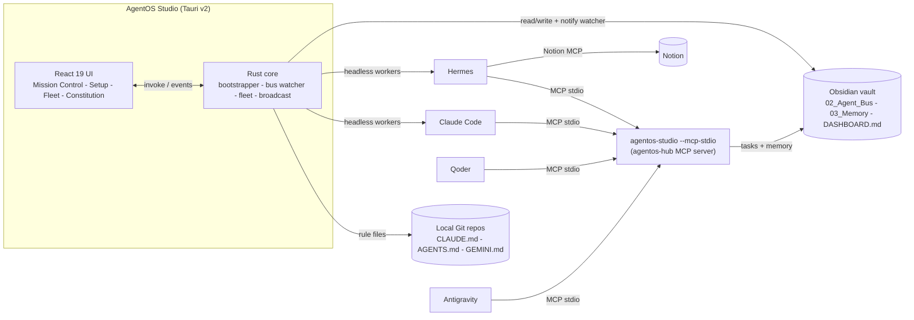

<p align="center">
  
</p>

<h1 align="center">AgentOS Studio</h1>

<p align="center">
  <b>Stop copy-pasting prompts between terminals and IDEs.</b><br />
  Turn Hermes, your Claude subscription, Qoder, Antigravity, Obsidian and Notion into one autonomous engineering fleet.
</p>

<p align="center">
  <a href="https://github.com/konethegreat/agentos-studio/actions/workflows/ci.yml"></a>
  
  
  
  
</p>

---

Wiring a multi-agent setup by hand means hours of `PATH` fixes, CLI installs, OAuth logins, Python virtualenvs and hand-edited JSON in four different config files. Then you still end up pasting prompts from one tool into another.

**AgentOS Studio replaces all of that with one native desktop app and one Rust binary.**

- **1-click bootstrapper.** Detects and installs or repairs Git, GitHub CLI, Node, Claude Code, Hermes, the Claude subscription plugin, your Obsidian vault, Notion MCP and the IDE connectors. It runs the real installers and opens the real sign-in flows.
- **Native Rust MCP bus.** The same binary run with `--mcp-stdio` is `agentos-hub`, a stdio MCP server for a shared task queue and shared memory. It has no Python, no Node and no runtime dependencies.
- **Live Mission Control.** A Kanban board over your vault that updates within milliseconds when any agent claims or finishes work, plus headless Hermes and Claude Code workers whose output streams into the UI.
- **Fleet manager.** Finds every Git repo on your machine, keeps one constitution synced into each of them, and commits only the rule files. Your own work-in-progress is never staged.
- **Constitution studio.** Toggle laws, edit `CONSTITUTION.md` and `SYSTEM_CONTEXT.md`, then broadcast to the vault, your global user rules and every repository in one click.

## How it fits together



The vault is the single source of truth. Every task is a Markdown file with YAML frontmatter that moves `Pending/ -> In_Progress/ -> Completed/`, so humans can read and edit it in Obsidian and every agent sees the same state.

## Install and run

Prerequisites: [Rust](https://rustup.rs) (stable), Node.js 20+, and the [Tauri v2 system dependencies](https://v2.tauri.app/start/prerequisites/) for your OS (WebView2 is already present on Windows 10 and 11).

```bash
git clone https://github.com/konethegreat/agentos-studio.git
cd agentos-studio
npm install
npm run tauri dev        # run the desktop app with hot reload
npm run tauri build      # produce an installer in src-tauri/target/release/bundle
```

On first launch open **Setup and Integrations** and press **Auto-Setup and Repair Everything**. Anything missing gets installed, and sign-in windows open for Claude, GitHub and Notion. When it finishes, the health pill turns green: **All 6 Systems Connected**.

## The six pillars

| # | Pillar | What Studio checks | What the fix button runs |
|---|---|---|---|
| 1 | Claude Subscription Bridge | `claude --version`, `claude auth status`, Hermes plugin | `winget install Anthropic.ClaudeCode` or `npm i -g @anthropic-ai/claude-code`, `claude auth login`, `hermes plugins install claude-subscription-directsdk` |
| 2 | Hermes Agent Engine | `hermes --version`, default model in `config.yaml` | Official Hermes installer, `hermes model` |
| 3 | Obsidian Shared Brain | `00_Inbox` to `04_Agent_Engine` tree | Scaffolds the vault and seed files at any folder you pick |
| 4 | Notion Cloud Sync | Notion MCP server configured and authorized in Hermes | `hermes mcp install notion`, `hermes mcp login notion` |
| 5 | AgentOS Rust MCP Bus | Self-test over stdio (`initialize` + `tools/list` returns 6 tools), Hermes registration | `hermes mcp add agentos-hub --command <studio> --args --mcp-stdio --vault <vault>` |
| 6 | IDE Fleet Connectors | `agentos-hub` in `~/.claude.json`, `~/.qoder/settings.json`, `~/.gemini/config/mcp_config.json` | `claude mcp add` and JSON merges (existing files are backed up once) |

Foundations (Git, GitHub CLI, Node, user `PATH` entries for `~/.local/bin`, npm and Cargo) are checked and repaired the same way. Studio also resolves tools through the persisted user `PATH`, so a freshly installed CLI works without restarting the app.

## The native MCP server

The desktop binary doubles as the MCP server. No GUI starts in this mode, and stdout carries only JSON-RPC.

```bash
agentos-studio --mcp-stdio --vault "/path/to/your/vault"
```

Register it with any MCP client. Studio's Setup view does this for you; manually it looks like this:

```bash
claude mcp add agentos-hub --scope user -- /path/to/agentos-studio --mcp-stdio --vault "/path/to/vault"
```

```json
{
  "mcpServers": {
    "agentos-hub": {
      "command": "C:\\Program Files\\AgentOS Studio\\agentos-studio.exe",
      "args": ["--mcp-stdio", "--vault", "C:\\Users\\you\\Obsidian\\My vault"]
    }
  }
}
```

| Tool | Purpose |
|---|---|
| `delegate_task(title, assigned_to, creator, project, context_files, instructions, priority)` | Create a task in `02_Agent_Bus/Pending/` for `hermes`, `claude-code`, `qoder`, `antigravity` or `human` |
| `fetch_pending_tasks(agent_name)` | Open tasks for one agent or `all`, sorted by priority |
| `claim_task(task_id, agent_name)` | Move a task to `In_Progress/` |
| `complete_task(task_id, agent_name, summary_of_work)` | Move a task to `Completed/` with a completion summary |
| `write_shared_memory(topic, content, category)` | Create or append a note in `03_Memory/` and log it in `DECISION_LOG.md` |
| `search_shared_memory(query)` | Ranked keyword search across `01_Projects/` and `03_Memory/` |

Every state change regenerates the task section of `DASHBOARD.md`. Writes are atomic and guarded by a cross-process lock, so the GUI, the MCP server and other tools can share one vault safely. The file format is compatible with the original AgentOS Python server.

## Mission Control

Type a one-line goal in the command bar, pick a repository and an agent, and press **Dispatch Mission**.

- **Hermes / Auto** and **Claude Code** missions are claimed and run immediately as headless workers (`hermes chat --oneshot --query-file`, `claude -p --output-format stream-json`). Output streams live into the slide-over worker drawer, which also has **Stop Worker**.
- **Qoder** and **Antigravity** missions are queued on the bus. The rule files tell those IDE agents to call `fetch_pending_tasks` at the start of every session.
- Every card has **Run Now (Hermes)**, **Run Now (Claude)**, **Move State** and **View Spec / Logs**. Worker logs are kept in `04_Agent_Engine/worker_logs/`.

Claude Code workers run with `--permission-mode acceptEdits` and access to the `agentos-hub` tools. Tool permissions beyond that follow your own Claude Code settings.

## Fleet and constitution

- **Fleet Repositories** scans your home folder (plus OneDrive Desktop and Documents) for Git repos and shows stack, branch, status, uncommitted files and whether the rules are synced.
- **Sync Constitution** writes managed blocks into `CLAUDE.md`, `AGENTS.md` and `GEMINI.md` (your own text outside the block is preserved), plus `.qoder/rules/agentos.md`, `.agents/rules/agentos.md` and a `.gitignore` section for local agent caches. With **Commit rule files only**, the commit is built from `HEAD` plus those files in a private index. Your staged and unstaged work stays exactly where it was.
- **New AgentOS Project** creates the folder, runs `git init`, lays down a Rust, TypeScript or Python starter, injects the rules, makes the first commit, optionally creates the GitHub repo with `gh`, writes the `01_Projects/<name>.md` note and queues a Notion sync task for Hermes.
- **Save and Broadcast** writes `CONSTITUTION.md` and `SYSTEM_CONTEXT.md`, regenerates the vault templates, updates `~/.claude/CLAUDE.md`, `~/.qoder/AGENTS.md` and `~/.gemini/GEMINI.md`, and syncs every repository. Disabled laws are left out of every generated file.

## Project layout

```
src/                      React 19 + TypeScript + Tailwind 4 UI
  views/                  MissionControl, SetupWizard, FleetManager, ConstitutionStudio
  components/             CommandBar, TaskCard, WorkerDrawer, UI kit
  lib/api.ts              Typed bindings for every Rust command and event
src-tauri/src/
  main.rs                 GUI by default, MCP server with --mcp-stdio
  mcp_stdio.rs            JSON-RPC 2.0 MCP server
  vault.rs                Task bus, shared memory, dashboard, cross-process lock
  bootstrapper.rs         Stack detection, installers, OAuth launchers, registrations
  bus.rs                  notify watcher, mission dispatch, headless workers
  fleet.rs                Repo scanner, rule sync, rules-only commits, project creator
  constitution.rs         Managed blocks, law toggles, line-ending safe writes
  broadcast.rs            Save and Broadcast
templates/CONSTITUTION.md Default constitution bundled into the binary
```

## Development

```bash
npm run build                 # tsc + vite
npm run check:dashes          # repository-wide em-dash / en-dash gate
cd src-tauri
cargo fmt --check
cargo clippy --all-targets -- -D warnings
cargo test                    # vault, MCP protocol, fleet commits, constitution transforms
```

Contributions follow the AgentOS constitution in [`CLAUDE.md`](CLAUDE.md): branch, atomic conventional commits, PR, self-review, squash merge.

## License

[MIT](LICENSE)
