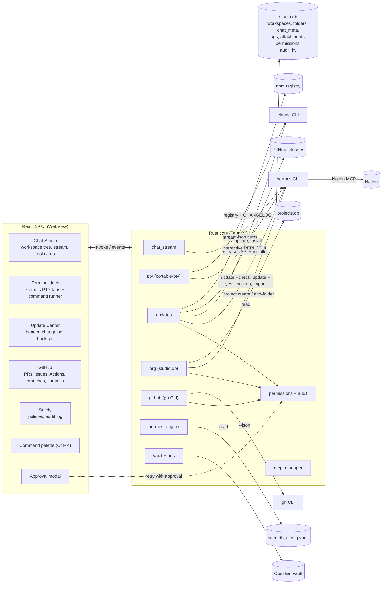

# AgentOS Studio architecture (v0.3)

AgentOS Studio is a GUI control plane over the Hermes agent runtime. It owns no agent logic. Everything it does goes through one of three Hermes surfaces:

1. The public CLI (`hermes chat --format stream-json`, `hermes update`, `hermes project`, `hermes mcp`, `hermes config set`, `hermes sessions delete`, `hermes import`).
2. Hermes's own files (`config.yaml`, `.env` key names only, `state.db`, `projects.db`, model caches), read directly and never written.
3. An interactive Hermes process inside a real pseudo terminal (ConPTY on Windows, openpty on macOS and Linux), for anything the CLI only exposes interactively (live reasoning, slash commands, approvals typed at the prompt).

Studio keeps a small store of its own (`studio.db`) only for things Hermes has no concept of: nested folders, chat placement, tags, attachments, permission policies, the audit log and update preferences.

## System diagram



## Startup (`boot.rs`, `single.rs`)

Every launch runs a fixed sequence before the app shows data, because the most common support
question is "it did not start" and the honest answer is usually one specific check.

| Step | What it does | If it fails |
|---|---|---|
| `dirs` | Creates the app's config, log and backup folders | Reported, boot continues |
| `path` | Repairs this process's PATH from the persisted user PATH plus known bin folders | Reported |
| `settings` | Loads `settings.json`, resolves the vault | Warning with the folder it used |
| `store` | Opens `studio.db` and applies migrations | Failed, boot continues read-only |
| `vault` | Checks the vault structure, creates missing folders only | Repaired or failed |
| `tools` | Probes git, node, gh, hermes and claude in parallel with a timeout each | Warning, names the missing tool |
| `hermes` | Parses `config.yaml`, reads provider, model and MCP counts | Failed with a pointer to the repair screen |
| `mcp` | Checks that `agentos-hub` is registered in Hermes and Claude Code | Warning with a pointer to sync |

Rules:

- **Only safe repairs run automatically.** Creating folders, applying migrations and fixing the
  PATH are idempotent and cannot destroy anything. Writing another tool's configuration,
  installing software and signing in are reported with a view to fix them, never done silently.
- **Every step is bounded.** Tool probes use a 4 second cap and run in parallel, so a missing tool
  costs one timeout, not five.
- **The report is streamed and cached.** Steps arrive on `agentos://boot` as they finish; the
  finished report is cached to `boot-snapshot.json` so the next launch paints instantly, and
  appended to `logs/boot.log` (last 400 runs).
- **Panics are logged.** `install_panic_hook` writes `logs/crash.log` with a message, location and
  backtrace, and the next launch shows the most recent entry on the boot screen. A GUI app with no
  console would otherwise die silently.
- **One instance only.** `single.rs` binds `127.0.0.1:47823`. A second launch asks the running
  instance to focus its window and exits, so a double click never produces a second heartbeat, a
  second vault watcher or a second fleet scan. No native dependency.

The UI defers its heavy loads (stack status, fleet scan, board) until the boot report says done, so
the first paint is never competing with a full probe.

## Components

| Module | Responsibility |
|---|---|
| `chat_stream.rs` | One streaming chat turn per message for Hermes or Claude Code; parses stream-json into UI events. |
| `hermes_surfaces.rs` | Hermes features shown, not rebuilt: built-in memory and journey, insights, security audit, cron jobs, profiles with Studio's role assignment, and `hermes send` for mission notices. Reads Hermes files directly; every change runs a Hermes command behind Studio's permission check. |
| `acp.rs` (spike, unwired) | Agent Client Protocol client for `hermes acp`: new or loaded session, one streamed turn, permission requests answered through a channel, cancel. Kept to re-run `tests/live_acp_spike.rs` against new Hermes releases; see `ACP-SPIKE.md`. |
| `pty.rs` (new) | Real terminals: spawn a shell, interactive Hermes, `hermes --resume <id>`, Claude Code or `claude --resume <id>` in a PTY; streams bytes as UTF-8 safe chunks, accepts keystrokes and resizes. |
| `updates.rs` (new) | Version detection for Hermes, Claude Code and Studio; changelog extraction; skip and snooze state; OS notifications; backup, update and rollback runners. |
| `org.rs` (new) | `studio.db`: workspaces, nested folders, chat placement, pins, tags, attachments, archive; links folders to Hermes projects through `hermes project`. |
| `github.rs` (new) | Typed wrappers over `gh ... --json` for auth, repos, branches, commits, PRs (diff, checks, review, merge, create), issues (create, comment, close) and Actions runs (logs, rerun). |
| `permissions.rs` (new) | Per-action policy (`allow`, `ask`, `deny`) enforced in Rust before any sensitive command runs, plus the append-only audit log. |
| `hermes_engine.rs` | Heartbeat, provider switchboard, model discovery, sessions in `state.db`. |
| `mcp_manager.rs` | MCP registry across four agents, native MCP client, catalog. |
| `cli_runner.rs` | One-shot command runner (kept for quick actions with captured output). |
| `vault.rs`, `bus.rs`, `mcp_stdio.rs` | Agent Bus, shared memory and the `agentos-hub` MCP server. |

### Approval flow

Sensitive commands take an `approved: bool` argument. `permissions::guard(action, approved)` runs first:

- `deny`: refused, audited as `denied`.
- `ask` and not approved: returns `APPROVAL_REQUIRED|<action>|<summary>`. The UI shows the approval modal (what will run, against what, whether it can be undone) and re-invokes with `approved = true`, optionally switching the policy to `allow`.
- `allow`, or `ask` and approved: runs, audited as `ok` or `error` with the error text.

The check lives in Rust, so a UI bug cannot skip it.

### Who owns what with Hermes

Hermes owns execution of Hermes work: sessions, tools, approvals of dangerous commands, checkpoints
and its own memory. Studio owns cross-agent policy: orchestration across Hermes, Claude Code and
Antigravity, the mission review gate and merge, the vault, and visibility. Studio talks to Hermes
through its CLI (`hermes chat -q`, `hermes sessions`, `hermes config set`, ...). The Agent Client
Protocol was evaluated as the chat transport and deferred (`ACP-SPIKE.md`): Hermes approvals in
Studio chat are therefore still denied by `approvals.single_query_mode`.

## Data model (`studio.db`)

Location: `<config dir>/agentos-studio/studio.db` (`%APPDATA%\agentos-studio` on Windows). Hermes sessions stay in Hermes's `state.db`; Studio stores placement only.

```sql
workspaces  (id TEXT PK, name, color, sort, archived, created_at)
folders     (id TEXT PK, workspace_id -> workspaces ON DELETE CASCADE,
             parent_id -> folders ON DELETE CASCADE, name, path, project_slug,
             pinned, archived, sort, created_at)
chat_meta   (session_id TEXT PK, folder_id -> folders ON DELETE SET NULL,
             workspace_id -> workspaces ON DELETE SET NULL, pinned, archived, updated_at)
tags        (name TEXT PK, color)
item_tags   (item_kind 'chat'|'folder', item_id, tag -> tags ON DELETE CASCADE, PK all three)
attachments (id TEXT PK, owner_kind 'chat'|'folder', owner_id, path, label, added_at)
permissions (action TEXT PK, policy 'allow'|'ask'|'deny')
audit       (id INTEGER PK, at, action, target, detail, outcome)
kv          (key TEXT PK, value)          -- update skips, snoozes, notified versions
```

Placement rules:

- A chat with a `chat_meta.folder_id` lives in that folder.
- Otherwise it is placed automatically in the folder whose `path` is the longest prefix of the session `cwd` (the same rule Hermes projects use). Auto-placed chats are marked so the user can see why they are there.
- Everything else is "Unfiled".
- Deleting a folder never deletes chats: they go back to Unfiled. Deleting a Hermes session is a separate, guarded action.

Attachments are references to files on disk, not copies. When a chat with attachments sends a message, the attached paths (chat plus its folder chain) are listed at the top of the prompt so the agent reads them with its own file tools, and the chat shows exactly which files were included.

## Folder structure

```
src/
  App.tsx                    shell, navigation, palette, approval and update providers
  components/
    ApprovalProvider.tsx     guarded calls and the approval modal
    CommandPalette.tsx       Ctrl+K
    PtyTerminal.tsx          xterm.js terminal bound to a Rust PTY
    CliDrawer.tsx            terminal dock: command runner tab + PTY tabs
    UpdateBanner.tsx         in-app update alert
    WorkspaceTree.tsx        workspaces > folders > chats, drag and drop
  views/
    ChatStudio.tsx           chat (now with the workspace tree and terminal handoff)
    UpdateCenter.tsx         versions, changelogs, backups, rollback
    GitHubView.tsx           repos, PRs, issues, Actions, branches, commits
    SafetyCenter.tsx         permission policies and audit log
  lib/
    api.ts                   typed bindings for every Rust command and event
    org.ts                   tree building and placement rules (pure, tested by tsc)
src-tauri/src/
  pty.rs  updates.rs  org.rs  github.rs  permissions.rs  (new in v0.3)
docs/
  ARCHITECTURE.md  ROADMAP.md  adr/
```

## Navigation shell (v0.4.1)

The twelve-item sidebar is gone. Navigation is a 56 px icon rail that expands to 208 px on hover or
when pinned, with the pin stored in `studio.db` (`kv.nav.pinned`). Five groups:

| Group | Tabs |
|---|---|
| Chat | Chat Studio |
| Work | Projects, Mission Control, Fleet |
| Brain | Skills, Constitution (Memory joins in item 7 of the same release) |
| Code | GitHub |
| System | MCP and Providers, Updates, Safety, Setup, Diagnostics |

Badges are counts, not decoration: open bus tasks on Work, pending updates on System, failing
workflow runs on Code (from `gh run list` for the repository bound to the current folder, refreshed
every three minutes). `Alt+1..5` select a group, `Ctrl+K` still reaches every tab by name.

The top bar no longer repeats provider and model, which belong to the per-chat switcher. It carries
the Hermes version and a single health chip that opens Diagnostics.

## Working directory resolution

A GUI inherits whatever directory its launcher had, and on Windows that is sometimes
`C:\Windows\System32`. `workdir.rs` resolves a new chat's folder in this order: last folder used
(`studio.db` kv `chat.cwd`), the active project root (`projects.db`, falling back to the only
project when there is exactly one), then the user's home. A candidate is rejected when it is
relative, missing, under `%WINDIR%`, or any path segment is `system32`. `pick()` is pure so the rule
is unit tested without touching the environment.

## Memory ledger

`memory_ledger` in `studio.db` (schema 3) records `(session_id, turn, op, target, path, tool, at)`
for every memory-touching tool call in a chat turn. It is written from the `tool_use` events the
chat stream already parses, so the strip under a message is derived from evidence, not from the
model's summary. Classification is by tool name: `recall`, `search_shared_memory`, `project_brief`
and read tools are reads; `remember`, `write_shared_memory` and edit tools are writes; any Notion
tool is `target: notion`; agentos-hub memory tools are `target: vault`; everything else that touches
a file is `target: file`. Turn numbers come from the UI, which sends the 1-based user turn with each
message, so rows attach to the message that caused them.

## Typed memory

`03_Memory` notes gain `type` (`decision`, `fact`, `convention`, `episode`, `gotcha`), `status`
(`active`, `superseded`), and optional `supersedes`, `source_session`, `agent` and `repo`.
`DECISION_LOG.md` is appended to only by `type: decision`, so the log keeps meaning what it says.
Notes written before types existed have no `type` and read as `fact` at read time; nothing is
rewritten. Superseding is the one deliberate write to an older note: it flips that note to
`status: superseded` and records `superseded_by`.
