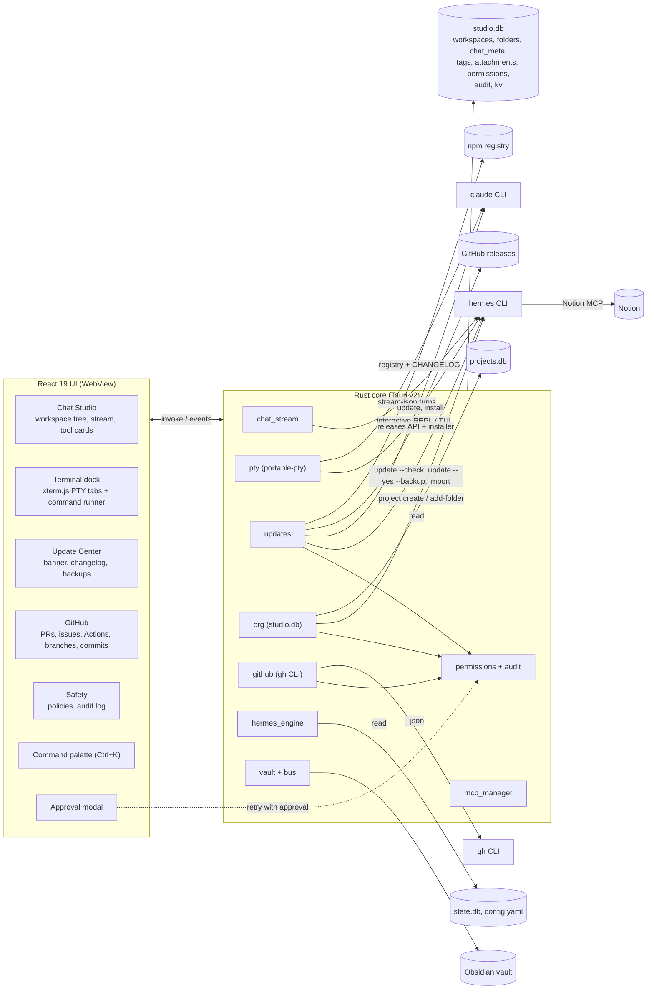

# AgentOS Studio architecture (v0.3)

AgentOS Studio is a GUI control plane over the Hermes agent runtime. It owns no agent logic. Everything it does goes through one of three Hermes surfaces:

1. The public CLI (`hermes chat --format stream-json`, `hermes update`, `hermes project`, `hermes mcp`, `hermes config set`, `hermes sessions delete`, `hermes import`).
2. Hermes's own files (`config.yaml`, `.env` key names only, `state.db`, `projects.db`, model caches), read directly and never written.
3. An interactive Hermes process inside a real pseudo terminal (ConPTY on Windows, openpty on macOS and Linux), for anything the CLI only exposes interactively (live reasoning, slash commands, approvals typed at the prompt).

Studio keeps a small store of its own (`studio.db`) only for things Hermes has no concept of: nested folders, chat placement, tags, attachments, permission policies, the audit log and update preferences.

## System diagram



## Startup (`boot.rs`, `single.rs`)

Every launch runs a fixed sequence before the app shows data, because the most common support
question is "it did not start" and the honest answer is usually one specific check.

| Step | What it does | If it fails |
|---|---|---|
| `dirs` | Creates the app's config, log and backup folders | Reported, boot continues |
| `path` | Repairs this process's PATH from the persisted user PATH plus known bin folders | Reported |
| `settings` | Loads `settings.json`, resolves the vault | Warning with the folder it used |
| `store` | Opens `studio.db` and applies migrations | Failed, boot continues read-only |
| `vault` | Checks the vault structure, creates missing folders only | Repaired or failed |
| `tools` | Probes git, node, gh, hermes and claude in parallel with a timeout each | Warning, names the missing tool |
| `hermes` | Parses `config.yaml`, reads provider, model and MCP counts | Failed with a pointer to the repair screen |
| `mcp` | Checks that `agentos-hub` is registered in Hermes and Claude Code | Warning with a pointer to sync |

Rules:

- **Only safe repairs run automatically.** Creating folders, applying migrations and fixing the
  PATH are idempotent and cannot destroy anything. Writing another tool's configuration,
  installing software and signing in are reported with a view to fix them, never done silently.
- **Every step is bounded.** Tool probes use a 4 second cap and run in parallel, so a missing tool
  costs one timeout, not five.
- **The report is streamed and cached.** Steps arrive on `agentos://boot` as they finish; the
  finished report is cached to `boot-snapshot.json` so the next launch paints instantly, and
  appended to `logs/boot.log` (last 400 runs).
- **Panics are logged.** `install_panic_hook` writes `logs/crash.log` with a message, location and
  backtrace, and the next launch shows the most recent entry on the boot screen. A GUI app with no
  console would otherwise die silently.
- **One instance only.** `single.rs` binds `127.0.0.1:47823`. A second launch asks the running
  instance to focus its window and exits, so a double click never produces a second heartbeat, a
  second vault watcher or a second fleet scan. No native dependency.

The UI defers its heavy loads (stack status, fleet scan, board) until the boot report says done, so
the first paint is never competing with a full probe.

## Components

| Module | Responsibility |
|---|---|
| `chat_stream.rs` | One streaming chat turn per message for Hermes or Claude Code; parses stream-json into UI events. |
| `acp_host.rs` | Hermes chat over ACP: creates sessions with interactive `hermes chat` (creation policy), runs turns on one long-lived `hermes acp` connection, routes updates and approval questions per session. `chat_stream.rs` drives it and falls back to `chat -q`. |
| `computer_use.rs` | Hermes computer use: toolset state from `hermes tools list`, the cua-driver Hermes installed (version, update, daemon), the `computer_use` results in `state.db` (read only), and screenshots served only from Hermes' image cache. |
| `notion_sync.rs` | Two-way Notion missions board: rows out per mission with a hash ledger; proposals and cancels in. |
| `model_layer.rs` | Hermes' model layer: fallback chain (`hermes config get/set fallback_providers`), credential pools (parsed `hermes auth list`; `auth.json` is never read), MoA presets, and Studio's per-folder default model for new chats. |
| `plans.rs` | Plan mode: the `/plan` prompt scoped to the chat folder, the newest plan in `.hermes/plans`, and the run prompt after approval. |
| `kanban.rs` | Hermes missions on Hermes' kanban board: create (model pinned at creation, implementer profile, `dir:` workspace, time cap), read runs, decide wait, review or block, collect worker session ids for spend, and run `hermes verify`. Kanban `done` is never Studio approval. |
| `learning.rs` (new) | The learning loop: one headless Hermes turn per finished mission writes validated lessons into `03_Memory` as typed notes, and repeated review blockers become one convention note per repository. Additive and idempotent; it never runs the reviewer. |
| `memory_quality.rs` (new) | The memory audit: finds notes whose backticked paths or functions no longer exist in the repository, asks one Hermes turn to judge pairs of active notes that share a topic and type, and marks the loser stale with `status: superseded` and `superseded_by`. Never deletes. Runs from the Brain panel and the `--memory-quality` headless flag, with an optional weekly cron job. |
| `skill_proposals.rs` (new) | Skills from success: approved missions grouped by role and a normalised verb plus object; three or more produce a `SKILL.md` draft with steps from the memory ledger, pitfalls and the missions as evidence. Approve creates it through one Hermes turn behind `hermes.skills.create`; Dismiss records `skills.dismissed.<hash>`. |
| `provenance.rs` (new) | Why a line is here: commit trailers for a mission merge (`Mission`, `Agent`, `Model`, `Reviewer`, `Cost`), a `git blame` of one line, and a merged-pull-request fallback mapped to a mission by `pr_url`. Read only. |
| `eval.rs` (new) | The evaluation harness: replays a finished mission at its pull request's base commit in a detached worktree on another agent or model, scores the repository's test command and a reviewer verdict on the replay's local diff, and writes one note to `03_Memory/evals`. Never pushes, never opens a pull request, never calls `review_agent::review`. |
| `hermes_surfaces.rs` | Hermes features shown, not rebuilt: built-in memory and journey, insights, security audit, cron jobs, profiles with Studio's role assignment, and `hermes send` for mission notices. Reads Hermes files directly; every change runs a Hermes command behind Studio's permission check. |
| `acp.rs` (spike, unwired) | Agent Client Protocol client for `hermes acp`: new or loaded session, one streamed turn, permission requests answered through a channel, cancel. Kept to re-run `tests/live_acp_spike.rs` against new Hermes releases; see `ACP-SPIKE.md`. |
| `pty.rs` (new) | Real terminals: spawn a shell, interactive Hermes, `hermes --resume <id>`, Claude Code or `claude --resume <id>` in a PTY; streams bytes as UTF-8 safe chunks, accepts keystrokes and resizes. |
| `updates.rs` (new) | Version detection for Hermes, Claude Code and Studio; changelog extraction; skip and snooze state; OS notifications; backup, update and rollback runners. |
| `org.rs` (new) | `studio.db`: workspaces, nested folders, chat placement, pins, tags, attachments, archive; links folders to Hermes projects through `hermes project`. |
| `github.rs` (new) | Typed wrappers over `gh ... --json` for auth, repos, branches, commits, PRs (diff, checks, review, merge, create), issues (create, comment, close) and Actions runs (logs, rerun). |
| `permissions.rs` (new) | Per-action policy (`allow`, `ask`, `deny`) enforced in Rust before any sensitive command runs, the append-only audit log, scoped MCP tool policies per agent and per project (repo > agent > global, stored in `kv` under `perm.`), and the unattended worker profile (environment allowlist and the guarantees Safety shows). |
| `hermes_engine.rs` | Heartbeat, provider switchboard, model discovery, sessions in `state.db`. |
| `mcp_manager.rs` | MCP registry across four agents, native MCP client, catalog. |
| `cli_runner.rs` | One-shot command runner (kept for quick actions with captured output). |
| `vault.rs`, `bus.rs`, `mcp_stdio.rs` | Agent Bus, shared memory and the `agentos-hub` MCP server. `bus.rs` also starts headless workers (Hermes, Claude Code, Antigravity) for the scheduler and the event-driven watcher. |
| `worktree.rs` | One git worktree and branch per bus mission attempt, excluded locally, removed when the mission ends. |
| `stuck.rs` | Heartbeat per running mission (kanban times and session messages, worker process and log, worktree changes); one retry, then blocked. |
| `hub_identity.rs` | Per-agent hub tokens (hash only in `studio.db`), caller resolution, the write-as-yourself and read-only rules, `whoami`. |
| `agents.rs`, `agent_log.rs` | Agent registry (start mode, strengths, tools, cost model, quota headroom, health) and the schema 9 exchange log every cross-agent step writes to. |
| `handoff.rs`, `ask.rs` | The `handoff` packet builder (receiver starts in the same worktree) and `ask_agent` (one headless turn on another agent, loop guard in kv). |
| `council.rs`, `assign.rs` | Design-decision councils on different providers with an ADR pull request, and quota-aware assignment of `auto` missions. |
| `timeline.rs` | Read-only run timeline per mission from the exchange log, bus, worker logs, kanban, `state.db` and the memory ledger. |
| `goals.rs` | Goals (schema 10): outcome, repositories, runnable done checks, metered budget, deadline, autonomy level and the per-repository default; the vault note `01_Projects/Goals/<id>.md`. Design in [GOALS.md](GOALS.md). |
| `planner.rs` | Splits a goal with `hermes kanban decompose --json` against a private `HERMES_KANBAN_DB` (no dispatcher scans it), mirrors the tasks as `auto` missions under the goal with their dependencies, Watch plan approval, and the scheduler's start rule for goal missions. |
| `goal_loop.rs`, `escalation.rs` | Each scheduler pass: merge approved work the autonomy level allows, raise the escalation list (budget, second reject, stuck or destructive, merge outside the allow list), apply answers once; escalations (schema 10) with a hashed phone code, options, a safe answer and a deadline. |
| `completion.rs` | Done checks for a goal whose missions are merged, in a detached worktree of the default branch; the report, outcome notes, Notion republish, one fix mission per failure and the `done_check` escalation. |
| `digest.rs` | Morning and evening digest (vault, Notion, `hermes send`) and escalation replies read from the gateway's `state.db` messaging sessions, read only. |
| `pause.rs` | The fleet pause switch: kv `fleet.paused` gates starting, merging and applying answers, and drives `hermes pause` and `hermes resume`. |

### Approval flow

Sensitive commands take an `approved: bool` argument. `permissions::guard(action, approved)` runs first:

- `deny`: refused, audited as `denied`.
- `ask` and not approved: returns `APPROVAL_REQUIRED|<action>|<summary>`. The UI shows the approval modal (what will run, against what, whether it can be undone) and re-invokes with `approved = true`, optionally switching the policy to `allow`.
- `allow`, or `ask` and approved: runs, audited as `ok` or `error` with the error text.

The check lives in Rust, so a UI bug cannot skip it.

### Scoped tool permissions

MCP tools have a policy of `allow`, `ask` or `deny` at three scopes, resolved **repo > agent >
global** for every hub session:

- **Global** is the `tool_policy` table, changed with `set_tool_policy`.
- **Agent** is one agent name, for example `qoder` or `claude-code`. Set it in Safety, or via
  `set_scoped_tool_policy("agent", "qoder", server, tool, policy)`.
- **Repo** is one project slug. It applies only to hub sessions that declare the project through
  the `AGENTOS_REPO` environment variable, which the launcher sets per mission, so unrelated
  sessions keep the agent and global policies. `AGENTOS_REPO` is trusted the same way the hub
  token is: both come from the environment the launcher hands the session.

The checks run inside `mcp_stdio.rs` with the caller already resolved from the hub token, so a
client cannot route around them. A denied tool is hidden from `tools/list` for that scope as well
as refused in `tools/call`, with the refusal naming the deciding scope ("blocked by the policy for
qoder", "requires approval under the policy for agentos-studio"). `ask` cannot prompt in a headless
session, so it refuses there, exactly like the global ask policy.

Scoped policies live as JSON in `kv` (`perm.tool.agent.<agent>`, `perm.tool.repo.<repo>`, index
`perm.tool.scopes`), not in the schema: no migration, and removing an override returns the tool to
the next scope down. Every change is audited as `tool_policy.set` with the target
`<scope>:<key>:agentos-hub/<tool>` and the detail `policy = allow|ask|deny|inherit`. The Safety view
lists the real hub tools, the registered hub agents and the unarchived projects, and shows per tool
whether the scope inherits, or sets its own policy.

### Unattended profile

A mission worker runs with nobody watching, so it gets less than a session a person started.
`permissions::unattended_env(base, repo, vault)` rebuilds the environment from a fixed allowlist
(PATH, temp folders, profile folders and the Windows basics), adds `AGENTOS_REPO` when the mission
names a project, always adds `AGENTOS_UNATTENDED=1` and `AGENTOS_VAULT`, and drops everything else.
API keys, tokens and any other variable the desktop app inherited never reach a headless agent; an
agent authenticates through its own config or the OS keychain.

Safety shows the profile as one row per guarantee with the side that holds it: `enforced` (live in
this build), `ready` (the helper ships here and takes effect when the Hermes worker calls it, which
is a REQUEST on the coordination note) and `hermes` (depends on the Hermes runtime, for example
worktree-only starts, egress rules and `hermes secrets`). The card also lists the allowlist, so the
rule is visible rather than implied.

### Who owns what with Hermes

Hermes owns execution of Hermes work: sessions, tools, approvals of dangerous commands, checkpoints
and its own memory. Studio owns cross-agent policy: orchestration across Hermes, Claude Code and
Antigravity, the mission review gate and merge, the vault, and visibility. Studio talks to Hermes
through its CLI (`hermes chat -q`, `hermes sessions`, `hermes config set`, ...). The Agent Client
Protocol was evaluated as the chat transport and deferred (`ACP-SPIKE.md`): Hermes approvals in
Studio chat are therefore still denied by `approvals.single_query_mode`.

## Data model (`studio.db`)

Location: `<config dir>/agentos-studio/studio.db` (`%APPDATA%\agentos-studio` on Windows). Hermes sessions stay in Hermes's `state.db`; Studio stores placement only.

```sql
workspaces  (id TEXT PK, name, color, sort, archived, created_at)
folders     (id TEXT PK, workspace_id -> workspaces ON DELETE CASCADE,
             parent_id -> folders ON DELETE CASCADE, name, path, project_slug,
             pinned, archived, sort, created_at)
chat_meta   (session_id TEXT PK, folder_id -> folders ON DELETE SET NULL,
             workspace_id -> workspaces ON DELETE SET NULL, pinned, archived, updated_at)
tags        (name TEXT PK, color)
item_tags   (item_kind 'chat'|'folder', item_id, tag -> tags ON DELETE CASCADE, PK all three)
attachments (id TEXT PK, owner_kind 'chat'|'folder', owner_id, path, label, added_at)
permissions (action TEXT PK, policy 'allow'|'ask'|'deny')
audit       (id INTEGER PK, at, action, target, detail, outcome)
kv          (key TEXT PK, value)          -- tool policy scopes (perm.), update skips, snoozes, notified versions
```

Placement rules:

- A chat with a `chat_meta.folder_id` lives in that folder.
- Otherwise it is placed automatically in the folder whose `path` is the longest prefix of the session `cwd` (the same rule Hermes projects use). Auto-placed chats are marked so the user can see why they are there.
- Everything else is "Unfiled".
- Deleting a folder never deletes chats: they go back to Unfiled. Deleting a Hermes session is a separate, guarded action.

Attachments are references to files on disk, not copies. When a chat with attachments sends a message, the attached paths (chat plus its folder chain) are listed at the top of the prompt so the agent reads them with its own file tools, and the chat shows exactly which files were included.

## Folder structure

```
src/
  App.tsx                    shell, navigation, palette, approval and update providers
  components/
    ApprovalProvider.tsx     guarded calls and the approval modal
    CommandPalette.tsx       Ctrl+K
    PtyTerminal.tsx          xterm.js terminal bound to a Rust PTY
    CliDrawer.tsx            terminal dock: command runner tab + PTY tabs
    UpdateBanner.tsx         in-app update alert
    WorkspaceTree.tsx        workspaces > folders > chats, drag and drop
  views/
    ChatStudio.tsx           chat (now with the workspace tree and terminal handoff)
    Today.tsx                home screen: what waits on you, goals, spend, agents and the digest
    UpdateCenter.tsx         versions, changelogs, backups, rollback
    GitHubView.tsx           repos, PRs, issues, Actions, branches, commits
    SafetyCenter.tsx         permission policies and audit log
  lib/
    api.ts                   typed bindings for every Rust command and event
    org.ts                   tree building and placement rules (pure, tested by tsc)
src-tauri/src/
  pty.rs  updates.rs  org.rs  github.rs  permissions.rs  (new in v0.3)
docs/
  ARCHITECTURE.md  ROADMAP.md  adr/
```

## Navigation shell (v0.4.1)

The twelve-item sidebar is gone. Navigation is a 56 px icon rail that expands to 208 px on hover or
when pinned, with the pin stored in `studio.db` (`kv.nav.pinned`). Six groups:

| Group | Tabs |
|---|---|
| Today | Today (the screen Studio opens on) |
| Chat | Chat Studio |
| Work | Projects, Mission Control, Fleet |
| Brain | Memory, Skills, Constitution |
| Code | GitHub |
| System | MCP and Providers, Updates, Safety, Setup, Diagnostics |

Badges are counts, not decoration: open bus tasks on Work, pending updates on System, failing
workflow runs on Code (from `gh run list` for the repository bound to the current folder, refreshed
every three minutes). `Alt+1..6` select a group, `Ctrl+K` still reaches every tab by name.

The top bar no longer repeats provider and model, which belong to the per-chat switcher. It carries
the Hermes version and a single health chip that opens Diagnostics.

### Today (home)

Studio opens on Today, the screen that answers "what needs me now". It reads only existing
commands: `goals_list` and `escalations_list` for the waiting section and goals in progress,
`list_missions` and `list_workers` for running agents, `fleet_pause_state` for the pause banner, and
`digest_latest`, a read-only addition that returns the newest note under `04_Agent_Engine/digests`
so the UI never writes a digest. Waiting on you comes first, in the digest's order (open
escalations, then goals in `awaiting`), so the screen and the morning message agree. From Today the
owner answers an escalation from its own options, approves a plan and resumes a paused fleet; every
other action links to Goals, Mission Control or Safety. The view polls every 15 seconds and has a
manual Refresh.

## Working directory resolution

A GUI inherits whatever directory its launcher had, and on Windows that is sometimes
`C:\Windows\System32`. `workdir.rs` resolves a new chat's folder in this order: last folder used
(`studio.db` kv `chat.cwd`), the active project root (`projects.db`, falling back to the only
project when there is exactly one), then the user's home. A candidate is rejected when it is
relative, missing, under `%WINDIR%`, or any path segment is `system32`. `pick()` is pure so the rule
is unit tested without touching the environment.

## Memory ledger

`memory_ledger` in `studio.db` (schema 3) records `(session_id, turn, op, target, path, tool, at)`
for every memory-touching tool call in a chat turn. It is written from the `tool_use` events the
chat stream already parses, so the strip under a message is derived from evidence, not from the
model's summary. Classification is by tool name: `recall`, `search_shared_memory`, `project_brief`
and read tools are reads; `remember`, `write_shared_memory` and edit tools are writes; any Notion
tool is `target: notion`; agentos-hub memory tools are `target: vault`; everything else that touches
a file is `target: file`. Turn numbers come from the UI, which sends the 1-based user turn with each
message, so rows attach to the message that caused them.

## Typed memory

`03_Memory` notes gain `type` (`decision`, `fact`, `convention`, `episode`, `gotcha`), `status`
(`active`, `superseded`), and optional `supersedes`, `source_session`, `agent` and `repo`.
`DECISION_LOG.md` is appended to only by `type: decision`, so the log keeps meaning what it says.
Notes written before types existed have no `type` and read as `fact` at read time; nothing is
rewritten. Superseding is the one deliberate write to an older note: it flips that note to
`status: superseded` and records `superseded_by`.

## Brain view

The Brain view shows the two memory stores side by side when there is room, and switches to Vault
and Hermes tabs below 1280 px: the window's minimum width is 1100 px, so the split would otherwise
have to work in two 550 px columns. The Vault column is the ranked index over `03_Memory` (type,
links, modified time) plus the recent ledger activity, which is what every agent reads through
`recall` and writes through `remember`. The Hermes column reads `MEMORY.md` and `USER.md` from the
Hermes home (`-p <profile>` when a profile is selected), marks them read-only, and lists the journey
nodes Hermes builds from skills and memory cards. Both columns report their own failure: a missing
file, an unreadable status or a journey
parse error shows in that column instead of blanking the screen. Deleting a journey node is the only
write the view offers, and it goes through `hermes.journey.delete` with the default policy `ask`.
Hermes does not expose a non-interactive edit: `hermes journey edit` opens `$EDITOR`, so the view
does not offer one. The Vault column also carries the Quality panel, which shows the last audit,
the stale and superseded counts, each change, and whether the weekly job is scheduled; the
Learning panel, which lists finished missions and writes their lessons; and the Skill proposals
panel, which drafts a skill from three approved missions and creates it only after the owner
approves.

## Learning loop

`learning.rs` turns finished work into memory. When a mission is `done` or `failed`, one short
headless Hermes turn receives the goal, acceptance criteria, review verdict and note, the files the
pull request changed and its summary, and must answer with a JSON array of one to five lessons
(`decision`, `convention` or `gotcha`). Every lesson is written through `Vault::write_typed_memory`
with `agent: agentos-learning`, the mission's `repo` and the turn's `source_session`. The answer is
all or nothing: a single malformed entry drops the whole answer and nothing is written.
`learning.done.<mission id>` records a completed extraction, so a rerun skips the turn. A dropped
answer is not recorded, so the next run may try again.

The second path is deterministic. Rejected missions from the last 30 days are grouped by their
normalised review reasons (bullet lists first, otherwise the first sentence). A group of two or more
writes one convention note named `Review blockers in <repo>`, links the missions and records their
ids in the store so a rerun writes nothing. `conventions_for` condenses those notes newest first and
caps them at 1500 characters for a future implementer prompt.

The model turn is injected (`lessons_with`), so the write path, the skip rule and the retry after a
dropped answer are unit tested without running Hermes. The live check (`tests/live_learning.rs`)
is ignored by default and runs only under the live-machine lock when the owner has allowed Hermes
use.

## Memory quality

`memory_quality.rs` audits the vault without deleting anything. A note is stale when it names a
backticked path (`src/`, `src-tauri/` or `docs/`, with an optional `:line`) that does not exist in
the repository checkout, or a backticked function (`name()` or `module::name`) that
`git grep -w` cannot find. A folder that is not a git checkout returns "unknown" and the note is
left alone. Contradiction candidates are two active notes of the same normalised topic and type
(`convention` or `fact`) whose bodies differ and carry a cheap opposition signal (one says "never"
where the other says "always", or the numbers disagree). One short Hermes turn answers a single
strict JSON object per pair, `{"verdict":"contradiction"|"compatible","keep":<note>,"reason":...}`;
a malformed answer drops every verdict and nothing is written.

A confirmed stale note or contradiction loser is marked through the existing supersede path:
frontmatter gains `status: superseded`, `superseded_by` and `superseded_reason`, and `updated`
moves. A note edited in the last seven days is reported only and never changed. The report is
stored in `studio.db` under `memory_quality.last_run` on a real run, so the panel and the weekly
job agree. The turn is injected (`run_with`), so every write path is unit tested offline.

The audit runs on demand from the Brain Quality panel and headlessly:
`agentos-studio.exe --memory-quality --vault <vault>` (add `--dry-run` to print changes without
writing). "Schedule weekly check" writes `agentos-memory-quality.py` under the Hermes scripts
folder and creates `0 6 * * 1 --name agentos-memory-quality --no-agent --script
agentos-memory-quality.py` behind the `hermes.cron.change` permission; the job names the script by
file name alone, because Hermes resolves it inside the profile's scripts folder and rejects an
absolute path. The live check (`tests/live_memory_quality.rs`) is ignored by default.

## Skills from success

`skill_proposals.rs` reads approved missions (status `done`, verdict `approve`) and groups them by
role and by a task class: a normalised verb plus object from the goal ("Add the learning loop"
becomes `add learning loop`). Three missions in one group produce a proposal. The draft is a
`SKILL.md` whose frontmatter has the name and a description under 60 characters that starts with
"Use when", followed by steps taken from the memory ledger's tool sequence for those missions (or a
short generic sequence when the ledger is empty), pitfalls, and the missions as evidence. Nothing
is searched, installed or written until the owner acts.

Approve runs one short Hermes turn on the default profile, or on a named profile, and asks it to
create the skill from the draft with its skill creation tool; `hermes skills install` cannot take a
local file. Success is confirmed by scanning the profile's skills folder for the name, so a turn
that answers without creating the skill is an error. The action is gated by `hermes.skills.create`,
which defaults to ask. Dismiss writes `skills.dismissed.<hash>` through `store::kv_set`, and the
hash is a stable function of the role and the task class, so the group is not proposed again. The
turn is injected (`approve_with`), so the prompt and the confirmation rule are unit tested offline;
the live check (`tests/live_skill_proposals.rs`) is ignored by default.

## Provenance

`provenance.rs` answers "why is this line here?" from git and the mission store. A mission merge
appends a trailer block to its commit message: `Mission: M-012`, `Agent: claude-code`,
`Model: <model>`, `Reviewer: <agent>`, and `Cost: $0.42` for metered work, `Cost: flat` for a
subscription or `Cost: $0.00` for a local model. `Goal:` waits for Phase D, when goals become an
entity. `trailers` renders the block and `parse_trailers` reads it back; unknown keys and prose are
ignored and the last occurrence wins.

`why(repo, file, line)` resolves a local checkout (an absolute folder, a project slug, or an
`owner/name` whose clone is a known project), runs `git blame --porcelain -L line,line`, and reads
the blamed commit's message. A commit that names a mission is resolved from the store. Otherwise the
merged pull request whose merge commit or head is that sha is found with `gh pr list --search <sha>
--state merged` and mapped to a mission by `pr_url`. A line that only exists in the working tree
blames to an all-zero id and is reported as "not committed yet". A lookup that cannot run (no `gh`,
no GitHub remote, offline) becomes a note on the answer instead of an error, because the commit and
its trailers are still the useful part. Paths must be relative and stay inside the checkout.

The backend half is pure enough for unit tests through injected blame, message and pull-request
seams; the live check (`tests/live_provenance.rs`) runs a real `git blame` on a temporary repository
under the live-machine lock and needs no Hermes turn. Brain shows the form, and the GitHub diff view
blames any new line with a hover `why` action against the local clone. The merge hook appends the
same trailers to the commit: `review_agent::merge` builds the pull request title and body, adds
`provenance::trailers`, and merges with `github::pr_merge_with`, so a mission merged by Studio
resolves to its mission without the PR mapping fallback. The squash subject keeps GitHub's `(#n)`
form, and a pull request whose title or body cannot be read is not merged, because the trailers are
the merge record.

## Evaluation harness

`eval.rs` answers "would another agent have done this better?" for a finished mission. It reads the
mission's pull request with `gh pr view --json baseRefOid,url`, checks that the base commit exists
locally (fetching if not), and creates a detached worktree under `.worktrees/` from that commit. The
chosen agent (`claude-code` or `hermes`, optionally with a model) gets one turn with the mission's
goal and acceptance criteria and the instruction to make the change in place and stop. The replay is
not a mission: Claude Code gets `--permission-mode acceptEdits` and no shell allowlist, so it cannot
push or call `gh`, and the Hermes turn runs with `--ignore-rules` so the repository's constitution
does not send it to open a pull request. The worktree is detached and removed by a guard on every
path out, including errors.

The replay's diff is collected after `git add -A`, so new files count, and the repository's own test
command runs next: `npm test` when package.json carries a real script, otherwise `cargo test`,
`go test ./...`, or pytest when a Python project marker exists. A JavaScript worktree gets one quiet
`npm install` first. The score is 50 for passing tests (0 failing, 25 when the repository has no test
command) plus 50 for a reviewer approval. The reviewer prompt and answer parser are
`review_agent::prompt` and `review_agent::parse_verdict`, but never `review_agent::review`: that
function takes a mission id and would move a real mission's status. The reviewer is the other agent
(`hermes` when the replay ran on Claude Code, `claude-code` otherwise), with the reviewer profile
from `hermes_surfaces` for Hermes.

Each replay writes one note to `03_Memory/evals/<date>-<mission>-<agent>-<model>.md` through
`vault::Doc`, so the frontmatter is YAML that reads back with the same parser: mission, agent, model,
reviewer, score, original score, verdict, tests, cost, duration, base commit, comparison. The
original score comes from the same rubric applied to the mission's `hermes verify` record and
`review_verdict`. Claude Code cost is counted as flat (the subscription), Hermes cost from
`usage::metered_cost` over both session ids. The Brain view has an Evaluations panel that lists the
notes and starts a replay behind the `eval.run` permission (default ask). The memory index skips
`03_Memory/evals`, so run records never mix with memory notes.

The router rule from the brief is in `router.rs`: a model may become the default only when at least
three of its own eval notes scored better than the mission they replayed. Level or losing replays do
not count, and the shadow log records the decline when the evidence is short. The live check
(`tests/live_eval.rs`) is ignored by default: it replays one finished sandbox mission, asserts one
note was written, and asserts no worktree, no local branch and no routing change remain.
