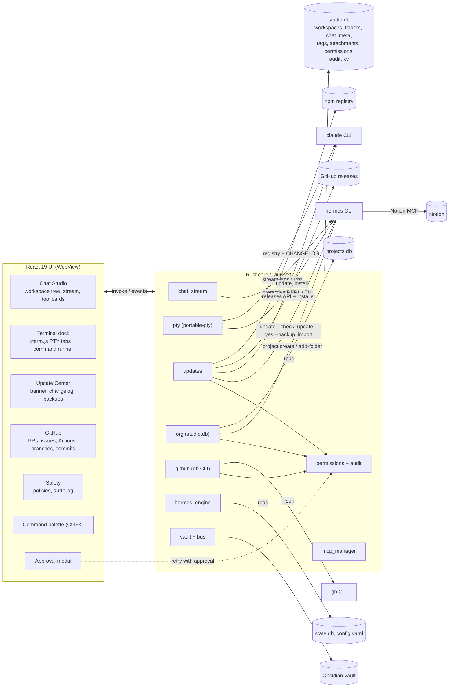

# AgentOS Studio architecture (v0.3)

AgentOS Studio is a GUI control plane over the Hermes agent runtime. It owns no agent logic. Everything it does goes through one of three Hermes surfaces:

1. The public CLI (`hermes chat --format stream-json`, `hermes update`, `hermes project`, `hermes mcp`, `hermes config set`, `hermes sessions delete`, `hermes import`).
2. Hermes's own files (`config.yaml`, `.env` key names only, `state.db`, `projects.db`, model caches), read directly and never written.
3. An interactive Hermes process inside a real pseudo terminal (ConPTY on Windows, openpty on macOS and Linux), for anything the CLI only exposes interactively (live reasoning, slash commands, approvals typed at the prompt).

Studio keeps a small store of its own (`studio.db`) only for things Hermes has no concept of: nested folders, chat placement, tags, attachments, permission policies, the audit log and update preferences.

## System diagram



## Components

| Module | Responsibility |
|---|---|
| `chat_stream.rs` | One streaming chat turn per message for Hermes or Claude Code; parses stream-json into UI events. |
| `pty.rs` (new) | Real terminals: spawn a shell, interactive Hermes, `hermes --resume <id>`, Claude Code or `claude --resume <id>` in a PTY; streams bytes as UTF-8 safe chunks, accepts keystrokes and resizes. |
| `updates.rs` (new) | Version detection for Hermes, Claude Code and Studio; changelog extraction; skip and snooze state; OS notifications; backup, update and rollback runners. |
| `org.rs` (new) | `studio.db`: workspaces, nested folders, chat placement, pins, tags, attachments, archive; links folders to Hermes projects through `hermes project`. |
| `github.rs` (new) | Typed wrappers over `gh ... --json` for auth, repos, branches, commits, PRs (diff, checks, review, merge, create), issues (create, comment, close) and Actions runs (logs, rerun). |
| `permissions.rs` (new) | Per-action policy (`allow`, `ask`, `deny`) enforced in Rust before any sensitive command runs, plus the append-only audit log. |
| `hermes_engine.rs` | Heartbeat, provider switchboard, model discovery, sessions in `state.db`. |
| `mcp_manager.rs` | MCP registry across four agents, native MCP client, catalog. |
| `cli_runner.rs` | One-shot command runner (kept for quick actions with captured output). |
| `vault.rs`, `bus.rs`, `mcp_stdio.rs` | Agent Bus, shared memory and the `agentos-hub` MCP server. |

### Approval flow

Sensitive commands take an `approved: bool` argument. `permissions::guard(action, approved)` runs first:

- `deny`: refused, audited as `denied`.
- `ask` and not approved: returns `APPROVAL_REQUIRED|<action>|<summary>`. The UI shows the approval modal (what will run, against what, whether it can be undone) and re-invokes with `approved = true`, optionally switching the policy to `allow`.
- `allow`, or `ask` and approved: runs, audited as `ok` or `error` with the error text.

The check lives in Rust, so a UI bug cannot skip it.

## Data model (`studio.db`)

Location: `<config dir>/agentos-studio/studio.db` (`%APPDATA%\agentos-studio` on Windows). Hermes sessions stay in Hermes's `state.db`; Studio stores placement only.

```sql
workspaces  (id TEXT PK, name, color, sort, archived, created_at)
folders     (id TEXT PK, workspace_id -> workspaces ON DELETE CASCADE,
             parent_id -> folders ON DELETE CASCADE, name, path, project_slug,
             pinned, archived, sort, created_at)
chat_meta   (session_id TEXT PK, folder_id -> folders ON DELETE SET NULL,
             workspace_id -> workspaces ON DELETE SET NULL, pinned, archived, updated_at)
tags        (name TEXT PK, color)
item_tags   (item_kind 'chat'|'folder', item_id, tag -> tags ON DELETE CASCADE, PK all three)
attachments (id TEXT PK, owner_kind 'chat'|'folder', owner_id, path, label, added_at)
permissions (action TEXT PK, policy 'allow'|'ask'|'deny')
audit       (id INTEGER PK, at, action, target, detail, outcome)
kv          (key TEXT PK, value)          -- update skips, snoozes, notified versions
```

Placement rules:

- A chat with a `chat_meta.folder_id` lives in that folder.
- Otherwise it is placed automatically in the folder whose `path` is the longest prefix of the session `cwd` (the same rule Hermes projects use). Auto-placed chats are marked so the user can see why they are there.
- Everything else is "Unfiled".
- Deleting a folder never deletes chats: they go back to Unfiled. Deleting a Hermes session is a separate, guarded action.

Attachments are references to files on disk, not copies. When a chat with attachments sends a message, the attached paths (chat plus its folder chain) are listed at the top of the prompt so the agent reads them with its own file tools, and the chat shows exactly which files were included.

## Folder structure

```
src/
  App.tsx                    shell, navigation, palette, approval and update providers
  components/
    ApprovalProvider.tsx     guarded calls and the approval modal
    CommandPalette.tsx       Ctrl+K
    PtyTerminal.tsx          xterm.js terminal bound to a Rust PTY
    CliDrawer.tsx            terminal dock: command runner tab + PTY tabs
    UpdateBanner.tsx         in-app update alert
    WorkspaceTree.tsx        workspaces > folders > chats, drag and drop
  views/
    ChatStudio.tsx           chat (now with the workspace tree and terminal handoff)
    UpdateCenter.tsx         versions, changelogs, backups, rollback
    GitHubView.tsx           repos, PRs, issues, Actions, branches, commits
    SafetyCenter.tsx         permission policies and audit log
  lib/
    api.ts                   typed bindings for every Rust command and event
    org.ts                   tree building and placement rules (pure, tested by tsc)
src-tauri/src/
  pty.rs  updates.rs  org.rs  github.rs  permissions.rs  (new in v0.3)
docs/
  ARCHITECTURE.md  ROADMAP.md  adr/
```
