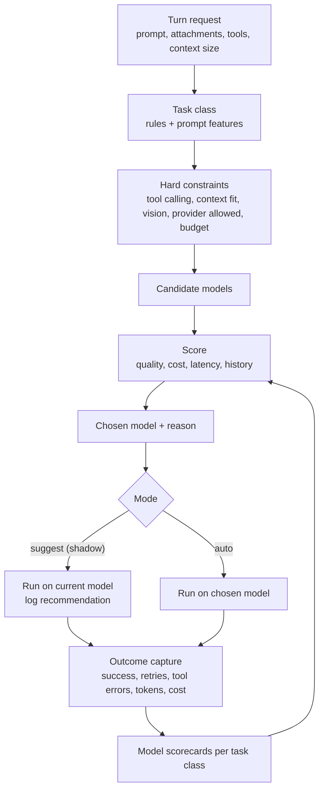

# Auto model routing

Design for v0.6.0. The goal is a model choice that is right for the task, cheap, explainable, and
always overridable. This document records the approach, the alternatives considered, and the
reasons for the order of work.

## The problem

A single default model is either too expensive for small turns or too weak for hard ones. Users end
up switching by hand, or leaving an expensive model running all day. Hermes makes switching easy,
but the choice still lands on the user before every turn.

There is also a freshness problem: providers ship new models constantly, and a fixed model list in
the app ages badly. By the time a hand-curated list ships, it is often already out of date.

## What we will not do

**We will not use a model call to choose the model.** It is the obvious design, and it is a trap:

- it adds latency and cost to every turn, including the cheap ones it is meant to save;
- it is not reproducible, so a bad decision cannot be debugged;
- it double-spends when the classifier is wrong, which is exactly when money matters most;
- it hides the decision from the user, who is the person paying for it.

A small local classifier could help later, but it will only ever adjust scores that a human can
read, never take over the decision.

**We will not silently change the default model.** Predictability matters more than cleverness. A
model that changes under the user's feet breaks prompt caching, confuses debugging and makes cost
impossible to attribute. Auto routing is opt-in per workspace, and every choice is visible.

**We will not route by benchmark scores alone.** Public benchmarks do not describe your repository,
your tools, your prompts or your acceptance criteria.

## Architecture

### 1. Task classification

Deterministic first, using features we already have:

| Signal | Source |
|---|---|
| Attachment types (image, PDF, long text) | the turn payload |
| Estimated input size | token estimate of prompt, history and files |
| Tools required | @-mentions, slash command, workspace tags, MCP selection |
| Task verbs and shape | prompt rules: review, explain, refactor, test, migrate, research |
| Workspace tags and pins | `studio.db` folder and workspace metadata |
| Prior turn in the same chat | continuation tends to keep the same class |
| Shell or browser work | tool selection in the composer, `/gh`, PTY handoff |

Task classes for v0.6.0: `chat`, `code-edit`, `code-review`, `test-or-debug`, `research`,
`long-context`, `vision`, `shell-ops`. Classes are a closed set so they can be scored and audited.
Expanding the set requires an evaluation run, not just a code change.

### 2. Hard constraints

A model that cannot do the job is not a candidate, whatever its score:

- tool calling required when the turn will use tools;
- vision required when the turn has images or PDFs;
- context window must cover the estimated input with headroom for output;
- the provider must be allowed by policy and have a usable credential;
- the model must be inside the remaining budget for the period;
- reasoning effort must exist for the model if the user asked for a level.

Failing a constraint is reported in the UI ("no candidate model can see images"), not silently
downgraded.

### 3. Scoring

Score = weighted sum over quality, cost, latency, with weights per task class. Quality starts from
capability metadata and model tier, then is replaced by measured results as scorecards fill in.

Example weights:

| Class | Quality | Cost | Latency |
|---|---|---|---|
| chat | 0.4 | 0.45 | 0.15 |
| code-edit | 0.65 | 0.25 | 0.10 |
| code-review | 0.7 | 0.2 | 0.1 |
| long-context | 0.6 | 0.35 | 0.05 |
| shell-ops | 0.5 | 0.3 | 0.2 |

Weights are data in a policy file, so they can be tuned without a rebuild, and every change is
versioned with its evaluation result.

### 4. Escalation ladder

For classes where verification is cheap (code-edit, test-or-debug), the router can start at the
cheapest viable model and escalate only when verification fails:

1. run on the cheap candidate;
2. verify with the workspace's own checks (tests, linter, type check) or a self-check prompt;
3. on failure, escalate one tier and retry, at most twice;
4. on repeated failure, stop and report, with every attempt listed in the timeline.

This costs more tokens but far fewer failed turns than a prediction that guessed wrong. It is also
the honest way to learn: the escalation record is a labelled example for the scorecards.

### 5. Outcome capture and scorecards

Every turn already produces the data, from v0.4 onward: tool calls, retries, errors, tokens, cost
and duration. A turn is "good" when it completed without an error, needed no immediate manual
retry, and its verification passed when verification existed. Scorecards aggregate per model and
task class with a minimum sample size, and show their sample count next to the number. No scorecard
influences routing below a confidence floor.

### 6. Shadow mode and rollout

1. **Suggest only:** run the user's model, log what auto would have chosen and why. Weekly report:
   would-be cost, latency and escalations.
2. **Opt-in per workspace:** auto routing enabled by the user, with a pin override always visible.
3. **Default suggestion:** new workspaces start with auto as the suggestion, not as the default.

Rollout stops at step 2 if the shadow report does not show a real improvement. That is a success
case, not a failure: it means the user's own choice was already good.

### 7. Cost guardrails

Routing and budget ship together:

- budget per workspace and overall, monthly, with a warning at 80 percent;
- hard pause on dispatch when the budget is exhausted, with an explicit override;
- per-turn cost shown before sending when the estimate is above a threshold;
- a "why this cost" breakdown in the turn inspector.

## Data model

Additions to `studio.db`:

| Table | Purpose |
|---|---|
| `model_policy` | scoring weights, allowed providers, budget caps, mode (`off`, `suggest`, `auto`) per workspace |
| `turn_outcome` | one row per turn: chosen model, task class, tokens, cost, duration, retries, errors, verification result, user retry |
| `router_decision` | model recommended, model used, reason, policy version, timestamp |
| `model_score` | aggregate per model and task class: sample count, success rate, median cost, median duration |
| `eval_run` | evaluation runs: policy version, prompt set, results, notes |

Everything here is local. Nothing about the user's routing leaves the machine unless they export it.

## Evaluation harness

A policy change is not shipped on intuition. The harness replays a fixed set of real tasks from the
user's history (chosen by them, redacted on request) against a candidate policy or model, and writes
a Markdown report into the vault, so the vault is the record of why routing changed. Notion gets the
summary line only.

## Open questions

- How much of the task classifier can run from prompt text alone before it needs the file tree?
- Should reasoning effort be part of routing (cheap model at high effort versus strong model at low
  effort)? Probably yes, but it doubles the candidate space, so it needs the evaluation harness
  first.
- How long should scorecards keep decaying old data when providers silently update a model behind a
  stable name?
- Should routing respect time of day (provider rate limits and latency vary), and if so, by how much
  before it becomes unpredictable?
